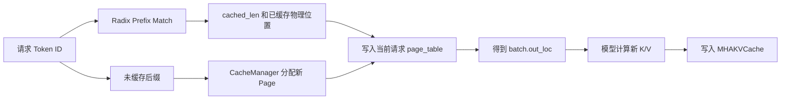
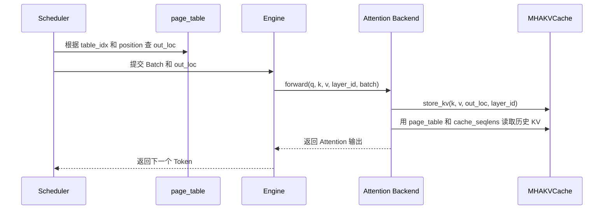
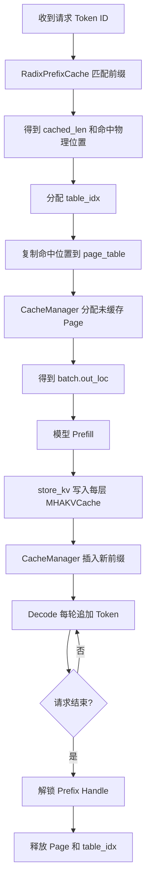

## 问题

在 `002_kv.md` 中，我们通过 nano-vLLM 理解了：

```text
预分配 KV Cache 池
请求通过 block_table 找到物理 Block
slot_mapping 指定新 K/V 的写入位置
```

mini-sglang 也采用“预分配池 + 分页访问”的思路，但它的组织方式更接近一个显式的内存管理系统：

```text
MHAKVCache          预分配 GPU KV 页池
page_table          每个请求的 Token 位置到物理位置的映射
CacheManager        分配、释放和扩展页面
RadixPrefixCache    根据 Token 前缀复用已有页面
out_loc             本轮新 K/V 的写入位置
```

本文重点是 mini-sglang 如何管理这些索引和存储，不重复解释 Q、K、V 的基础数学。相关基础可以先阅读 `002_kv.md`。

## 1. 先看 mini-sglang 的整体结构

mini-sglang 中，模型计算和 KV Cache 管理由不同对象负责：

```text
Scheduler
├── TableManager：管理请求使用哪一行 page_table
├── CacheManager：管理 KV 页面和前缀缓存
└── Batch：组织本轮 Prefill 或 Decode 请求

Engine
├── model：执行模型层
├── page_table：GPU 上的请求位置表
├── kv_cache：GPU 上的 K/V 页池
└── attention_backend：根据 page_table 读取 K/V
```

和 nano-vLLM 的主要区别是：nano-vLLM 的 `Sequence.block_table` 是 CPU 侧每个请求的一张 Block ID 列表；mini-sglang 为每个请求预留 `page_table` 的一行，并把位置映射表直接放在 GPU 上。

## 2. MHAKVCache：真正保存 K/V 的 GPU 页池

### 2.1 Tensor 的形状

`MHAKVCache` 初始化时创建：

```python
self._kv_buffer = torch.empty(
    (
        2,
        num_layers,
        num_pages,
        page_size,
        local_kv_heads,
        head_dim,
    ),
    device=device,
    dtype=dtype,
)
```

逻辑形状是：

```text
_kv_buffer[K/V][Layer][Page][Token Offset][KV Head][Head Dim]
```

其中：

```text
0 / 1       K 或 V
Layer       第几层 Attention
Page        KV Cache 中的物理页
Token Offset 页内第几个 Token
```

`page_size` 是一个物理页能够容纳的 Token 数。它和 nano-vLLM 的 `block_size` 作用相似，但 mini-sglang 把这个单位称作 Page。

### 2.2 每一层看到自己的 Cache

`MHAKVCache.k_cache(layer_id)` 返回：

```python
self._k_buffer[layer_id]
```

因此 Attention 后端拿到某个 `layer_id` 时，使用的是该层的：

```text
k_cache：第 layer_id 层所有 Page 的 K
v_cache：第 layer_id 层所有 Page 的 V
```

同一个 Page ID 在每一层都有独立的数据：

```text
第 0 层 Page 7 → 第 0 层的 K/V
第 1 层 Page 7 → 第 1 层的 K/V
```

`page_size=1` 时，一个 Page 只有一个 Token；`page_size>1` 时，一个 Page 包含连续的一组 Token。Engine 会额外创建一个 dummy page 给 CUDA Graph 等场景使用。

## 3. page_table：每个请求自己的位置表

### 3.1 page_table 的两层含义

Engine 初始化时创建：

```python
self.page_table = torch.zeros(
    (max_running_req + 1, aligned_max_seq_len),
    dtype=torch.int32,
    device=self.device,
)
```

可以把它看成：

```text
page_table[请求槽位][Token 逻辑位置] = 物理 Token 位置
```

例如请求 A 占用 `table_idx=3`：

```text
page_table[3] = [0, 1, 2, 3, 8, 9, ...]
```

表示请求 A 的：

```text
逻辑 Token 0 → KV 池位置 0
逻辑 Token 1 → KV 池位置 1
逻辑 Token 2 → KV 池位置 2
逻辑 Token 3 → KV 池位置 3
逻辑 Token 4 → KV 池位置 8
逻辑 Token 5 → KV 池位置 9
```

这里的物理位置是把 Page 和页内 Offset 展平后的 Token 位置：

```text
physical_token = physical_page × page_size + page_offset
```

### 3.2 `table_idx` 不是物理 Page ID

`Req.table_idx` 表示请求使用 `page_table` 的哪一行：

```text
请求 A → page_table[3]
请求 B → page_table[8]
```

它只是请求槽位，不能直接当作 KV Page。真正的 KV 物理位置要继续读取：

```text
page_table[table_idx, logical_position]
```

mini-sglang 使用 `TableManager` 管理这些请求行：

```python
table_idx = self.table_manager.allocate()
```

请求结束后，行号归还：

```python
self.table_manager.free(req.table_idx)
```

### 3.3 token_pool 和 page_table 的区别

`TableManager` 还创建了：

```python
self.token_pool = torch.zeros_like(page_table, dtype=torch.int32)
```

这两个二维 Tensor 容易混淆：

```text
token_pool[table_idx, position] = Token ID
page_table[table_idx, position] = KV Cache 物理位置
```

`token_pool` 保存模型本轮要读取的 Token ID；`page_table` 保存这些 Token 对应的 K/V 存储位置。

## 4. CacheManager 如何分配物理 Page

### 4.1 free_slots 保存什么

`CacheManager` 初始化时：

```python
self.free_slots = torch.arange(num_pages) * page_size
```

假设：

```text
num_pages = 4
page_size = 2
```

那么初始空闲位置是：

```text
free_slots = [0, 2, 4, 6]
```

每个数字是一个 Page 的起始 Token 位置：

```text
Page 0 → physical token 0、1
Page 1 → physical token 2、3
Page 2 → physical token 4、5
Page 3 → physical token 6、7
```

这说明 mini-sglang 的底层 KV Pool 是按 Page 分配的，但它的 `page_table` 默认按 Token 位置记录映射。

### 4.2 `_allocate()` 和 `_free()`

分配 Page 时：

```python
allocated = self.free_slots[:needed_pages]
self.free_slots = self.free_slots[needed_pages:]
```

释放时：

```python
self.free_slots = torch.cat(
    [self.free_slots, indices[::self.page_size]]
)
```

因此，分配和释放不会创建或销毁 `MHAKVCache._kv_buffer`，只是借还物理位置。

### 4.3 allocate_paged() 如何写请求的 page_table

对每个请求，CacheManager 计算：

```python
first_page = ceil(req.cached_len / page_size)
last_page = ceil(req.device_len / page_size)
```

只为 `[cached_len, device_len)` 这段尚未缓存的 Token 分配 Page。随后 `_write_page_table()` 把分配出的物理 Token 位置写入：

```python
page_table[req.table_idx, logical_positions] = allocated
```

所以一个请求的 page_table 可能是：

```text
逻辑位置：  0  1  2  3 | 4  5
物理位置：  0  1  2  3 | 8  9
```

请求逻辑上连续，但物理 KV 位置可以不连续。

## 5. Prefill：命中前缀后只计算后缀

### 5.1 Req 中的几个长度

mini-sglang 的 `Req` 保存：

```text
input_ids       CPU 侧的完整 Token 序列
cached_len      已经存在于 Prefix Cache 的长度
device_len      当前已经放入 GPU token_pool 的长度
extend_len      本轮需要计算的长度
table_idx       使用 page_table 的哪一行
```

其中：

```python
extend_len = device_len - cached_len
```

例如：

```text
完整 Prompt：[A0, A1, A2, A3, A4]
命中前缀：  [A0, A1, A2]
cached_len = 3
device_len = 5
extend_len = 2
```

本轮只需要计算 A3、A4。

### 5.2 Prefill 的实际流程

`PrefillAdder` 首先调用：

```python
handle = self.cache_manager.match_req(req).cuda_handle
cached_len = handle.cached_len
```

如果命中前缀，就把命中的物理位置复制到当前请求的 `page_table` 行：

```python
page_entry.copy_(handle.get_matched_indices())
```

然后把尚未缓存的 Token ID 写入 `token_pool`，并由 `allocate_paged()` 分配新的物理 Page。

一次 Prefill 的数据流是：



## 6. `out_loc`：mini-sglang 版本的 slot_mapping

### 6.1 out_loc 从哪里来

Scheduler 准备 Batch 时执行：

```python
input_mapping = _make_input_tuple(batch, device)
batch.out_loc = self.engine.page_table[input_mapping]
```

`input_mapping` 包含：

```text
请求 table_idx
本轮 Token 的逻辑 position
```

于是：

```text
out_loc = page_table[table_idx, position]
```

它直接得到本轮每个 Token 对应的物理 Token 位置。

对比 nano-vLLM：

```text
nano-vLLM：block_table → block_id × block_size + offset → slot_mapping
mini-sglang：page_table[table_idx, position] → out_loc
```

mini-sglang 把“逻辑位置到物理位置”的结果提前写进了 GPU page_table，因此前向准备阶段可以直接查表得到 `out_loc`。

### 6.2 out_loc 如何写入每一层 KV

Attention 后端的 `forward()` 中：

```python
self.kvcache.store_kv(
    k, v,
    batch.out_loc,
    layer_id,
)
```

`MHAKVCache.store_kv()` 把当前层的 Cache 展平为：

```python
k_cache = self._k_buffer[layer_id].view(
    num_pages * page_size,
    local_kv_heads,
    head_dim,
)
```

然后调用 CUDA Store Kernel，根据 `out_loc` 写入：

```text
k_cache[out_loc[i]] = k[i]
v_cache[out_loc[i]] = v[i]
```

这里的 `out_loc` 是直接的物理 Token 行号，不需要再乘 `page_size`。这正是 `page_table` 和 `free_slots` 都保存“物理 Token 起始位置”的原因。

## 7. Attention 如何读取历史 KV

### 7.1 Attention 拿到哪些元数据

FlashAttention Backend 的 `prepare_metadata()` 为 Batch 准备：

```text
cu_seqlens_q     Query 在拼接 Batch 中的边界
cu_seqlens_k     Key/Value 在拼接 Batch 中的边界
cache_seqlens    每条请求当前有效长度
page_table       每条请求的物理 Page 映射
```

它从 GPU 的请求 page_table 中取出每个请求的 Page 起始位置：

```python
page_table[req.table_idx, :max_seqlen_k:self.page_size]
```

当 `page_size > 1` 时，再除以 `page_size` 转成 Attention Kernel 需要的 Page ID。

### 7.2 Decode 的读取过程

假设：

```text
page_size = 4
请求 A 的 page_table 行：
[0, 1, 2, 3, 8, 9, 10, 11]
```

Attention 的 Page Table 是：

```text
[0, 2]
```

表示：

```text
逻辑位置 0～3 → Page 0
逻辑位置 4～7 → Page 2
```

当前 Decode Token 的 Q 会传给：

```python
flash_attn_with_kvcache(
    q=q,
    k_cache=k_cache,
    v_cache=v_cache,
    page_table=page_table,
    cache_seqlens=cache_seqlens,
    cu_seqlens_q=cu_seqlens_q,
    cu_seqlens_k=cu_seqlens_k,
)
```

Attention Kernel 内部根据：

```text
logical_position
    → page_table[request, logical_position // page_size]
    → physical Page
    → page 内 offset
    → k_cache / v_cache
```

读取当前请求的历史 K/V。它和 nano-vLLM 的 Block Table 查找本质相同，只是 mini-sglang 使用显式的 Page Table，并把 Page Table 放在 GPU 上。

### 7.3 一个 Decode 的完整时序



注意：`out_loc` 负责当前 K/V 的写入，`page_table` 和 `cache_seqlens` 负责历史 K/V 的读取。

## 8. RadixPrefixCache 如何复用前缀

### 8.1 为什么不是 Hash Block，而是 Radix Tree

mini-sglang 的 Prefix Cache 可以选择：

```text
cache_type = naive
cache_type = radix
```

`NaivePrefixCache` 不进行前缀复用；`RadixPrefixCache` 使用 Radix Tree 保存：

```text
Token 前缀片段 → 对应的物理 KV 位置 indices
```

一个节点包含：

```python
node._key       # Token ID 片段
node._value     # 对应的物理位置
node._length    # 片段长度
node.children   # 后续分支
node.ref_count  # 是否被请求锁定
```

例如两个请求：

```text
请求 A：系统提示词｜请介绍 Python
请求 B：系统提示词｜请介绍 Go
```

Radix Tree 可以保存：

```text
根
└── 系统提示词 → indices [0,1,2,...]
    ├── 请介绍 Python → 后续 indices
    └── 请介绍 Go     → 后续 indices
```

### 8.2 匹配前缀

`CacheManager.match_req()` 调用：

```python
self.prefix_cache.match_prefix(
    req.input_ids[: input_len - 1]
)
```

它故意不匹配最后一个输入 Token，让最后一个 Token 仍然经过模型计算并产生本轮 logits。

Radix Tree 按 `page_size` 对齐匹配：

```python
match_len = align_down(match_len, self.page_size)
```

所以只有完整 Page 的前缀才会被复用。匹配结果包含：

```text
cached_len             命中的 Token 数
get_matched_indices()  命中 Token 对应的物理位置
```

### 8.3 插入和释放前缀

Prefill 完成后，Scheduler 会调用：

```python
self.cache_manager.cache_req(req, finished=False)
```

它把已经计算完成的：

```text
input_ids[:req.cached_len]
page_table[req.table_idx, :req.cached_len]
```

插入 Radix Tree。插入时可能出现三种区域：

```text
旧 Prefix Cache 已存在的区域
本次新加入 Prefix Cache 的区域
最后一个不完整、不能进入 Prefix Cache 的尾部区域
```

已经被 Prefix Cache 覆盖的重复物理位置会被释放，仍被请求使用的部分会通过 handle 保持锁定。

## 9. mini-sglang 如何处理显存不足

### 9.1 分配时优先淘汰可驱逐前缀

`CacheManager._allocate()` 发现空闲 Page 不足时：

```python
evicted = self.prefix_cache.evict(
    (needed_pages - free_pages) * page_size
)
```

只有 Prefix Cache 中未被锁定的节点可以被淘汰。`RadixPrefixCache` 用：

```text
ref_count = 0
叶子节点
时间戳最早
```

选择可驱逐节点，返回它们占用的物理位置，再放回 `free_slots`。

因此 mini-sglang 的优先策略是：

```text
先回收不再被请求引用的 Prefix Cache
再为新请求分配 Page
```

### 9.2 locked 和 evictable

一个 Prefix Cache handle 被请求使用时会加锁：

```python
self.prefix_cache.lock_handle(handle)
```

锁定后：

```text
ref_count > 0
该前缀属于 protected_size
不能被淘汰
```

请求结束或不再使用时解锁：

```python
self.prefix_cache.lock_handle(handle, unlock=True)
```

之后该前缀才可能进入 `evictable_size`，等待 LRU 式淘汰。

### 9.3 和 nano-vLLM 的差异

```text
nano-vLLM：空闲 Block 不够时，可能抢占运行中的请求并重新 Prefill
mini-sglang：优先淘汰未锁定的 Prefix Cache 页面，再分配新页面
```

mini-sglang 的 `CacheManager` 代码中没有把正在运行请求的 KV Cache 换到 CPU；它主要管理 GPU 页面和前缀缓存的淘汰。

## 10. Page、Block、slot 和 out_loc 的对应关系

为了和 `002_kv.md` 的概念对照：

| nano-vLLM | mini-sglang | 含义 |
| --- | --- | --- |
| KV Cache 大 Tensor | `MHAKVCache._kv_buffer` | 真正保存 K/V 的 GPU 存储 |
| Block | Page | 固定大小的 KV 存储单位 |
| `Sequence.block_table` | `page_table[table_idx]` | 逻辑位置到物理位置的映射 |
| `slot_mapping` | `out_loc` | 本轮新 K/V 的写入位置 |
| `context_lens` | `cache_seqlens` | 请求当前有效长度 |
| BlockManager | `CacheManager` | 分配和释放物理 KV 区域 |
| Hash Prefix Cache | `RadixPrefixCache` | 跨请求复用前缀 |

mini-sglang 多了一层值得注意的设计：

```text
page_table[table_idx, position]
    = 物理 Token 位置
```

所以 `out_loc` 可以直接从 GPU page_table 中索引得到；而 Attention 为了按 Page 读取，会把这些物理 Token 位置按 `page_size` 抽样并转换为 Page ID。

## 11. 一条请求的完整生命周期



其中最关键的生命周期变化是：

```text
输入 Token
  → 通过 Radix Tree 找到已有物理位置
  → 通过 page_table 补齐当前请求的逻辑到物理映射
  → 通过 out_loc 写入本轮新 K/V
  → 通过 page_table 和 cache_seqlens 读取历史 K/V
  → 请求结束后解锁并归还可复用资源
```

## 12. 总结

mini-sglang 的 KV Cache 管理可以记成四层：

```text
第 1 层：MHAKVCache
    预分配 GPU Tensor，保存所有 Layer 的 K/V Page

第 2 层：page_table
    为每个请求记录逻辑 Token 到物理 Token 位置的映射

第 3 层：CacheManager
    分配、释放 Page，并把映射写入 page_table

第 4 层：RadixPrefixCache
    按 Token 前缀复用物理位置，并管理锁定和淘汰
```

最值得记住的几个关系是：

```text
page_table：历史 KV 在哪里
out_loc：新 KV 写到哪里
cache_seqlens：历史 KV 读多长
layer_id：当前使用哪一层的 K/V
```

和 nano-vLLM 相比，mini-sglang 没有把 `block_table` 作为每个请求的 Python 列表直接传给 Attention，而是为每个请求维护 GPU 上的一行 `page_table`，再从这张表生成 `out_loc` 和 Attention 所需的 Page Table。

因此，一句话概括 mini-sglang：

> mini-sglang 把所有 Layer 的 KV Cache 预分配成 GPU Page Pool，用每个请求的 GPU Page Table 描述逻辑 Token 到物理位置的映射，用 `out_loc` 写入本轮新 K/V，用 `cache_seqlens` 和 Page Table 读取历史 K/V，再用 Radix Tree 复用和淘汰共享前缀。
