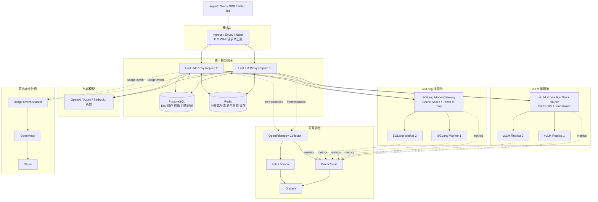
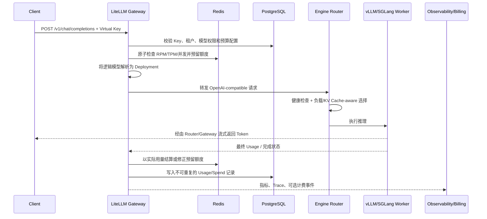

## 一、问题与结论

vLLM 和 SGLang 解决的是“如何高效执行一次模型推理”，但一个可以被多个业务、多个租户稳定调用的模型服务，还需要解决下面的问题：

- 对外暴露统一的 OpenAI-compatible API；
- API Key、租户、团队和模型权限管理；
- RPM、TPM、并发数、预算等限流；
- 请求重试、熔断、降级和模型路由；
- Token 用量统计、成本分摊，必要时生成账单；
- 指标、日志、链路追踪和 GPU 监控；
- 模型部署、扩缩容、灰度发布和故障恢复。

如果目标是**尽量使用开源组件、只做少量集成开发**，推荐的主方案是：

```text
统一模型网关：LiteLLM Proxy
网关状态存储：PostgreSQL + Redis
推理引擎：vLLM / SGLang
副本级路由：vLLM Production Stack Router / SGLang Model Gateway
运行环境：Kubernetes + NVIDIA GPU Operator + Helm
弹性伸缩：KEDA
监控：Prometheus + Grafana + DCGM Exporter
日志与追踪：Loki + OpenTelemetry Collector + Tempo/Jaeger
外部商业计费（可选）：OpenMeter + Stripe
```

其中最重要的设计是把路由拆成两层：

1. LiteLLM 负责“这个租户应该使用哪个逻辑模型、哪个推理池”；
2. vLLM Router 或 SGLang Model Gateway 负责“请求应该落到推理池中的哪个副本”。

第一层关心权限、成本、配额、可用区和模型能力；第二层关心实时负载、排队长度和 KV Cache 命中。两层解决的问题不同，不应该用一个普通的 Nginx 轮询同时替代。

## 二、目标与非目标

### 2.1 第一阶段目标

第一阶段只实现一条能够上线运行的最短路径：

- 业务只访问一个 `/v1` 地址；
- 同时接入 vLLM、SGLang 和必要的外部模型 API；
- 按租户发放 Virtual Key，并配置模型白名单；
- 支持 RPM、TPM、最大并发和消费预算；
- 保存每次请求的 Token、模型、租户、延迟和成本；
- 支持模型别名、主备切换、重试和熔断；
- 能观察 TTFT、TPOT、吞吐、排队长度、KV Cache 和 GPU 指标。

### 2.2 暂时不做

下面这些能力很有价值，但不应该进入第一版：

- 自研 OpenAI 协议适配层；
- 自研分布式限流器和 API Key 系统；
- 自研 KV Cache-aware 调度算法；
- 一开始就建设完整的模型管理平台和前端控制台；
- 在没有真实流量数据前实现语义路由；
- 为所有模型同时上 PD 分离、远端 KV Cache 和跨集群多活。

先把统一入口、稳定性、用量核算和可观测性做正确，再根据指标升级推理架构。

## 三、整体架构



架构可以分为数据面和控制面：

- **数据面**：Ingress、LiteLLM、推理池 Router、vLLM/SGLang Worker，负责处理在线请求；
- **控制面**：模型配置、Virtual Key、预算、价格表、Kubernetes/Helm、GitOps，负责决定数据面如何运行；
- **观测面**：Metrics、Logs、Traces、Usage Ledger，负责回答性能、稳定性和成本问题。

## 四、组件选择

| 能力 | 推荐组件 | 第一阶段职责 | 是否需要自研 |
| --- | --- | --- | --- |
| 统一 API 与模型网关 | LiteLLM Proxy | OpenAI API、Virtual Key、模型别名、路由、重试、预算、消费记录 | 只写配置和少量回调 |
| 关系数据 | PostgreSQL | Key、用户、团队、预算、模型配置、Spend Logs | 否 |
| 分布式状态 | Redis | 多网关副本共享限流、冷却状态、预算/路由计数 | 否 |
| 推理执行 | vLLM、SGLang | Continuous Batching、Paged/Radix KV Cache、张量并行、OpenAI API | 否 |
| vLLM 副本路由 | vLLM Production Stack Router | Prefix/KV/Load-aware 路由、服务发现 | 否 |
| SGLang 副本路由 | SGLang Model Gateway | Cache-aware、Power-of-two、健康检查、动态 Worker | 否 |
| GPU 编排 | Kubernetes、NVIDIA GPU Operator | GPU 驱动、Device Plugin、节点标签和工作负载编排 | 否 |
| 自动扩缩容 | KEDA | 根据 Prometheus 中的等待队列等指标扩缩容 | 否 |
| 指标 | Prometheus、Grafana、DCGM Exporter | 网关、引擎、GPU 指标与告警 | 只配置 Dashboard/Rule |
| 日志与追踪 | Loki、OpenTelemetry、Tempo/Jaeger | 请求关联、故障定位、分布式追踪 | 只统一字段 |
| 使用量计费 | LiteLLM；需要出账时加 OpenMeter | 内部分摊、预算；套餐、发票和支付 | 一个很薄的事件适配器 |
| 模型文件 | Hugging Face/ModelScope + S3/MinIO/PVC | 模型版本、下载缓存、启动挂载 | 只写发布流程 |
| 配置发布 | Helm + Argo CD（可选） | 版本固定、审计、回滚 | 否 |

### 4.1 为什么第一阶段选择 LiteLLM

LiteLLM 已经覆盖了最容易重复造轮子的部分：OpenAI-compatible API、Virtual Key、团队和模型权限、RPM/TPM、预算、Spend Tracking、多个 Deployment 的负载均衡、失败冷却、重试与 Fallback。

需要特别注意：预算功能依赖 PostgreSQL；无数据库部署不能当作可靠的预算控制。多副本网关还需要 Redis 共享计数和路由状态。相关行为应该以所固定版本的[预算与限流文档](https://github.com/BerriAI/litellm-docs/blob/main/docs/proxy/users.md)和[预算路由文档](https://github.com/BerriAI/litellm-docs/blob/main/docs/proxy/provider_budget_routing.md)为准。

### 4.2 其他网关什么时候更合适

| 方案 | 优势 | 相对本方案的代价 | 适用情况 |
| --- | --- | --- | --- |
| Apache APISIX AI Gateway | 高性能通用网关、AI Proxy、Redis Token 限流、丰富插件 | 租户预算、成本台账和 LLM 管理能力需要重新组合 | 团队已有 APISIX 平台 |
| Higress AI Gateway | 模型代理、Token 限流、Fallback、内容安全，对国内生态友好 | 完整计费和租户治理仍需补齐 | 团队已有 Higress/Envoy 体系 |
| Envoy AI Gateway | Kubernetes Gateway API、Envoy 数据面、云原生标准化 | 组件更偏流量基础设施，计费治理需要外接 | 大型 K8s 平台团队 |
| Kong AI Gateway | 成熟的 API 管理和插件生态 | 部分高级能力与版本授权需要逐项确认 | 企业已统一使用 Kong |
| 自研 Go 网关 | 能完全控制性能、协议和数据模型 | Key、限流、流式代理、计费、重试细节会形成长期维护成本 | 已有明确差异化需求且流量足够大 |

[APISIX 的 AI Token 限流](https://apisix.apache.org/docs/apisix/plugins/ai-rate-limiting/)已经支持 Redis 策略和多种 Token 口径，因此它不是能力不足，而是需要自行补齐租户、预算和账务控制面。最小开发原则下，LiteLLM 的组合更短。

## 五、为什么需要两层模型路由

### 5.1 第一层：模型网关路由

LiteLLM 看见的是逻辑模型和部署，例如：

```text
qwen-chat
├── qwen3-32b-vllm-shanghai
├── qwen3-32b-sglang-beijing
└── cloud-qwen-fallback
```

这一层可以依据以下信息决策：

- API Key 能访问哪些模型；
- 租户属于免费、标准还是高优先级套餐；
- 哪个 Deployment 仍有 RPM/TPM 和预算；
- 哪个区域可用、成本更低或延迟更小；
- 主模型失败后应该降级到哪个兼容模型；
- 灰度版本应该接收多少流量。

这里的模型路由是**业务和治理路由**。

### 5.2 第二层：推理副本路由

当请求已经选择了 `qwen3-32b-vllm-shanghai`，它仍然需要在多个 GPU 副本中选择一个：

```text
qwen3-32b-vllm-shanghai
├── replica-1：命中了 80% Prompt Prefix，但当前较忙
├── replica-2：没有命中 Prefix，但当前空闲
└── replica-3：正在恢复，暂不接流量
```

普通 Round Robin 看不到这些状态。vLLM Production Stack 已提供 Prefix/KV/Load-aware Routing；其中 Load-aware 策略会同时考虑匹配 Token 比例和实例实时负载，避免所有相同前缀都压到一个热点副本。参考[vLLM Production Stack](https://docs.vllm.ai/projects/production-stack/en/latest/)和[Load-aware Routing](https://docs.vllm.ai/projects/production-stack/en/latest/use_cases/loadaware-routing.html)。

SGLang Model Gateway 提供 `cache_aware`、`power_of_two`、`round_robin` 等策略，并支持健康检查、动态注册以及 Prefill/Decode 分离。其 Cache-aware 策略在负载均衡时维护近似前缀树；具体能力见[SGLang Model Gateway 文档](https://github.com/sgl-project/sglang/blob/main/docs/advanced_features/sgl_model_gateway.md)。

这里的副本路由是**推理效率路由**。

### 5.3 推荐规则

- 一个逻辑模型可以有多个 Deployment；
- 每个 Deployment 对应一个独立、同构的推理池；
- 推理池内部的 Worker 使用相同模型版本、Tokenizer 和关键启动参数；
- LiteLLM 只访问推理池 Router，不直接访问每一个 Worker；
- 不要再在 Router 与 Worker 之间增加普通 Round Robin Service，否则可能破坏 Cache Affinity；
- vLLM 和 SGLang 的同模型池可以做灰度或主备，但不要为了“看起来均衡”随机混用两个引擎。

## 六、一次请求的完整链路



处理顺序不能颠倒：应该先鉴权和准入，再占用稀缺 GPU 资源；实际用量在请求完成或连接断开后结算。

## 七、限流不是只有 RPM

### 7.1 至少需要五类限制

| 限制 | 解决的问题 | 推荐执行位置 |
| --- | --- | --- |
| RPM/RPS | 防止大量小请求冲击网关 | LiteLLM/边缘网关 |
| TPM | 控制实际模型计算量 | LiteLLM + Redis |
| Max Parallel Requests | 防止一个租户占满并发槽位 | LiteLLM + Redis |
| `max_tokens`、上下文长度、请求体大小 | 限制单个超大请求 | Ingress + LiteLLM |
| 推理池队列和最大并发 | 在 GPU 饱和时快速背压 | vLLM/SGLang Router |

只配置 RPM 会产生明显漏洞：一分钟 10 个、每个输出 32K Token 的请求，远比一分钟 100 个短请求昂贵。只配置 TPM 也不够，因为大量慢请求可以耗尽并发连接和 KV Cache。

### 7.2 分布式限流

当 LiteLLM 有多个副本时，限流计数必须放在 Redis，而不能保存在每个 Pod 的本地内存中，否则两个副本会分别放行一份额度。

建议限流键至少包含：

```text
tenant_id + api_key_id + model_alias + time_window
```

并按层级应用：

```text
平台全局上限
    -> 租户/团队上限
        -> API Key 上限
            -> 模型上限
                -> 推理 Deployment 上限
```

最具体的规则用于隔离调用方，上层规则用于保护共享基础设施。

### 7.3 Token 预留与结算

请求开始时只有输入 Token 和 `max_tokens` 是已知的，真实输出 Token 尚未产生。稳妥做法是：

```text
estimated_tokens = input_tokens + requested_max_output_tokens
```

1. 准入阶段按 `estimated_tokens` 预留 TPM/预算；
2. 请求正常完成后以 `actual_input_tokens + actual_output_tokens` 结算；
3. 将未使用的预留额度归还；
4. 客户端中断时仍记录已经生成的 Token；
5. 无法可靠计量时采取保守策略，并标记记录等待对账。

LiteLLM 已提供 TPM/RPM、并发和预算能力，第一阶段应优先使用其现成功能，而不是自己实现一套 Redis Lua 算法。但必须压测所固定的版本，确认多副本、流式中断、Redis 重启和预算边界的行为。

### 7.4 背压与错误码

- 租户配额耗尽：返回 `429`；
- 推理池队列已满：返回 `429` 或 `503`，并携带 `Retry-After`；
- 请求参数或上下文过长：返回 `400`；
- 没有健康 Deployment：返回 `503`；
- 超时发生在首个 Token 之前：可以重试或 Fallback；
- 已经开始流式输出：不能再透明切换模型，只能结束不完整流并让上层决定是否重试。

最后一条非常重要。SSE 已经向客户端发送内容后，再切换到另一个模型会造成重复、语义跳变和账务不一致。

## 八、计量、成本核算和收费是三件事

### 8.1 三个概念

| 概念 | 含义 | 第一阶段组件 |
| --- | --- | --- |
| Metering | 记录使用了多少资源 | LiteLLM Spend Log / Usage Log |
| Rating | 按价格表将用量换算为金额 | LiteLLM 自定义模型价格 |
| Billing | 套餐、余额、账期、发票、税和支付 | 暂不需要；商业收费时使用 OpenMeter |

LiteLLM 的“成本跟踪/预算”足够完成内部 Showback、Chargeback 和硬预算，但不应该把一张 Spend 表直接当成财务账单系统。

### 8.2 自托管模型如何定价

自托管模型没有云厂商提供的公开 Token 单价，可以先按单位时间总成本计算内部结算价：

```text
月度总成本
  = GPU 租用或折旧
  + CPU/内存/磁盘/网络
  + 空闲冗余
  + 运维成本

每 Token 成本
  = 月度总成本 / 月度有效计费 Token

对外或内部结算价
  = 每 Token 成本 × 风险与利润系数
```

输入和输出 Token 的计算特性不同，可以分别设置：

```text
input_cost_per_token
output_cost_per_token
```

每条用量记录还要保存 `pricing_version`，否则价格调整后无法重放历史账目。固定 Token 单价是一种管理口径，并不等于某次请求真实消耗的 GPU 成本；若需要成本优化分析，还应额外记录请求时长、GPU 型号、实例池和缓存命中率。

### 8.3 最小可用账务记录

每个请求至少记录：

```text
request_id                 全局唯一，用于幂等
tenant_id / team_id
api_key_id                 只保存 Key 标识，不保存明文
requested_model            用户请求的逻辑模型
served_model               实际执行的模型版本
deployment_id / engine
input_tokens
output_tokens
cached_tokens              引擎能够提供时记录
unit_price / pricing_version
amount
status / finish_reason
started_at / finished_at
ttft_ms / total_latency_ms
trace_id
```

`request_id` 必须贯穿 Gateway、Router、Worker、日志和账务记录。同一个完成事件重试写入时，数据库应使用唯一约束或 Upsert，避免重复扣费。

### 8.4 什么时候增加 OpenMeter

当系统需要下面任一能力时，再增加 OpenMeter：

- 预付费额度和套餐权益；
- 按月账期和阶梯价格；
- 客户级用量查询；
- 发票、税务和 Stripe 支付；
- 可重放、可审计的使用量事件流。

OpenMeter 使用 CloudEvents 接收使用事件，并按 `source + id` 去重，适合将 `request_id` 作为事件 ID。它原生支持按模型、Provider、输入/输出类型聚合 AI Token；参考[Usage Events](https://openmeter.io/docs/metering/events/usage-events)和[LLM Token Meter 示例](https://openmeter.io/docs/metering/guides/common-examples)。

此时只需要开发一个很薄的 `Usage Event Adapter`：从 LiteLLM 的成功回调或可靠 Outbox 中读取已完成请求，转换为 OpenMeter 事件。不要让外部计费系统处在 Token 流式返回的同步链路上，否则计费系统故障会扩大为模型 API 故障。

推荐事件格式：

```json
{
  "specversion": "1.0",
  "type": "llm.token.usage",
  "id": "request-01J...",
  "source": "llm-gateway",
  "subject": "tenant-123",
  "data": {
    "model": "qwen3-32b",
    "deployment": "qwen3-vllm-shanghai",
    "input_tokens": 1536,
    "output_tokens": 312,
    "pricing_version": "2026-09-v1"
  }
}
```

## 九、模型路由策略

### 9.1 使用稳定的模型别名

业务不要直接请求镜像版本或 Hugging Face 路径，而应该请求稳定别名：

```text
chat-default
chat-fast
chat-reasoning
embedding-default
rerank-default
```

别名背后再映射到：

```text
模型版本 + 推理引擎 + 区域 + 硬件池 + 发布批次
```

这样升级模型、切换引擎、灰度和回滚都不需要修改业务代码。

### 9.2 推荐的默认顺序

第一版使用确定性规则即可：

1. 校验租户模型白名单；
2. 按请求指定的能力选择模型族；
3. 过滤不健康、超预算、超限流的 Deployment；
4. 在主 Deployment 中按简单策略选择；
5. 首 Token 前出现可重试错误时切换同模型 Deployment；
6. 同模型全部失败后，才进入显式配置的 Fallback 模型；
7. 在响应元数据和账务记录中保存实际执行模型。

不要一开始就根据 Prompt 内容动态选择大模型或小模型。语义路由需要评测集、质量阈值和错误成本；没有离线评测和在线反馈闭环时，它只是不可解释的随机降级。

### 9.3 Fallback 兼容性

Fallback 模型必须检查能力兼容性：

- 是否支持 Tool Calling；
- 是否支持 JSON Schema/Structured Output；
- 上下文长度是否足够；
- 是否支持视觉、音频等输入；
- Tokenizer 与计费口径是否不同；
- 安全策略和数据地域是否允许。

例如带图片的请求不能降级到纯文本模型，要求严格 JSON Schema 的请求不能切到不支持约束解码的模型。

## 十、部署与扩缩容

### 10.1 最小开发环境

单机或少量 GPU 的开发环境可以使用 Docker Compose：

```text
LiteLLM × 1
PostgreSQL × 1
Redis × 1
vLLM × 1
SGLang × 1
Prometheus + Grafana
```

此时可以先直接访问单个引擎实例，不必为了形式完整部署内部 Router。开发环境的目标是验证协议、权限、限流、路由和账务链路。

### 10.2 生产环境

生产环境再迁移到 Kubernetes：

- LiteLLM 至少两个副本，使用 Pod Anti-Affinity；
- PostgreSQL 使用托管高可用版或成熟 Operator；
- Redis 使用高可用方案，并明确持久化和故障语义；
- 每个模型建立独立 Deployment/Pool；
- GPU 节点使用标签、Taint/Toleration 和 Node Affinity；
- 模型文件预下载到本地 NVMe/PVC，避免每次 Pod 启动从公网下载；
- Readiness Probe 必须在模型加载和 Warmup 完成后才成功；
- 滚动发布时先启动新池、完成 Warmup，再切流量并排空旧池。

### 10.3 自动扩缩容指标

不要只根据 GPU Utilization 扩缩容。LLM 的 GPU 利用率可能很高但队列仍然健康，也可能因为长 Prompt、KV Cache 压力而延迟恶化。

更有意义的信号包括：

```text
waiting_requests
running_requests
queue_time / TTFT
KV Cache usage
token throughput
请求拒绝率
```

vLLM Production Stack 已有使用 Prometheus `vllm:num_requests_waiting` 驱动 KEDA 的[自动扩缩容示例](https://docs.vllm.ai/projects/production-stack/en/latest/use_cases/autoscaling-keda.html)。

模型启动通常需要数分钟，因此：

- 在线低延迟模型不要轻易 Scale to Zero；
- 保留最小热副本；
- 扩容阈值要早于队列完全饱和；
- 缩容前设置较长冷却时间；
- 缩容先停止接收新请求，再等待现有流式请求完成。

## 十一、可观测性与 SLO

### 11.1 必须监控的指标

| 层级 | 核心指标 |
| --- | --- |
| Gateway | QPS、状态码、429、重试、Fallback、各租户 Token、成本、并发连接 |
| Router | 活跃请求、等待队列、Worker 健康、路由分布、Cache-aware 命中 |
| Engine | TTFT、TPOT/ITL、端到端延迟、输入/输出 Token/s、KV Cache Usage、Preemption |
| GPU | 利用率、显存、功耗、温度、ECC、XID Error、NVLink/PCIe 吞吐 |
| Storage/Network | 模型加载耗时、磁盘吞吐、跨节点网络、对象存储错误率 |

SGLang 可通过 `--enable-metrics` 暴露 TTFT、TPOT、吞吐和 Cache Hit Rate 等 Prometheus 指标，参见其[Production Metrics](https://github.com/sgl-project/sglang/blob/main/docs_new/docs/references/production_metrics.mdx)。vLLM 与 SGLang 的指标名称可能随版本变化，Dashboard 和告警规则应跟随镜像版本管理。

### 11.2 第一版 SLO

建议为每个模型池分别定义：

```text
可用性：成功请求 / 合法请求
p95 TTFT：用户多久看到第一个 Token
p95 TPOT：流式输出是否顺畅
p99 Queue Time：容量是否充足
429 比例：租户限流与平台过载分别统计
Usage 完整率：成功请求是否都有唯一账务记录
```

不要只看平均延迟。长尾 TTFT 和排队时间通常更能暴露容量、热 Key、模型加载和路由问题。

### 11.3 日志安全

- 默认不记录完整 Prompt 和模型输出；
- 日志只保存 Request ID、租户、模型、Token、延迟和错误摘要；
- 调试采样必须脱敏并设置短保留期；
- Virtual Key 只记录哈希或内部 ID；
- 管理 API 与推理 API 分开暴露；
- vLLM/SGLang Worker 只允许网关和 Router 在集群内访问。

## 十二、配置示例

下面的配置用于表达组件关系，字段需要按固定的 LiteLLM 版本做集成测试。

### 12.1 LiteLLM 模型与路由

```yaml
model_list:
  - model_name: chat-default
    litellm_params:
      model: hosted_vllm/Qwen/Qwen3-32B
      api_base: http://vllm-qwen-router.llm.svc.cluster.local/v1
      api_key: os.environ/VLLM_INTERNAL_KEY
      input_cost_per_token: 0.00000020
      output_cost_per_token: 0.00000080
    model_info:
      id: qwen3-32b-vllm-shanghai

  - model_name: chat-default
    litellm_params:
      model: openai/Qwen/Qwen3-32B
      api_base: http://sglang-qwen-router.llm.svc.cluster.local/v1
      api_key: os.environ/SGLANG_INTERNAL_KEY
      input_cost_per_token: 0.00000020
      output_cost_per_token: 0.00000080
    model_info:
      id: qwen3-32b-sglang-backup

router_settings:
  routing_strategy: simple-shuffle
  redis_host: os.environ/REDIS_HOST
  redis_port: os.environ/REDIS_PORT
  redis_password: os.environ/REDIS_PASSWORD
  num_retries: 1
  timeout: 120
  allowed_fails: 2
  cooldown_time: 30

general_settings:
  master_key: os.environ/LITELLM_MASTER_KEY
  database_url: os.environ/DATABASE_URL
```

实际生产中可以把两个引擎暴露为不同别名，只把其中一个配置为 Fallback；这样比无条件在 vLLM 和 SGLang 之间随机分流更容易解释和压测。

### 12.2 租户 Key

```json
{
  "key_alias": "media-agent-prod",
  "team_id": "media-agent",
  "models": ["chat-default", "embedding-default"],
  "rpm_limit": 120,
  "tpm_limit": 200000,
  "max_parallel_requests": 16,
  "max_budget": 500,
  "budget_duration": "30d"
}
```

生产系统不应把 Master Key 发给业务。每个环境、团队或应用使用独立 Virtual Key，才能撤销、审计和隔离额度。

### 12.3 SGLang 推理池 Router

```bash
python -m sglang_router.launch_router \
  --worker-urls http://sglang-0:8000 http://sglang-1:8000 \
  --policy cache_aware \
  --host 0.0.0.0 \
  --port 30000
```

第一版先采用默认的 `cache_aware` 或 `power_of_two`。只有压测证明默认策略不满足目标时，才调整 Cache Threshold、负载阈值或进入 PD 分离。

## 十三、分阶段实施计划

### 阶段 0：本地验证，约 2～3 天

```text
Docker Compose
  -> LiteLLM + PostgreSQL + Redis
  -> 单个 vLLM + 单个 SGLang
  -> Prometheus + Grafana
```

验收条件：

- 一个 OpenAI SDK 地址可以调用两个引擎；
- 不同 Virtual Key 只能访问自己的模型；
- RPM、TPM、并发和预算能够触发 `429`；
- 每次成功请求都能查询到 Token 和 Spend 记录；
- 流式请求、客户端中断和超时均有测试。

### 阶段 1：最小生产版，约 1～2 周

- Kubernetes + NVIDIA GPU Operator；
- LiteLLM 双副本；
- 每个核心模型一个推理池和内部 Router；
- Prometheus/Grafana/DCGM + Loki/Tempo；
- 固定模型镜像、模型文件和配置版本；
- 灰度发布、Warmup、Readiness、Drain 和回滚；
- 基于等待队列和 TTFT 的容量告警。

验收条件：

- 网关单 Pod、Worker 单 Pod 故障不会导致整体不可用；
- 首 Token 前的失败可以重试或 Fallback；
- 账务记录以 `request_id` 幂等；
- 压测达到目标吞吐，并给出 TTFT/TPOT/成本基线。

### 阶段 2：规模化优化

根据真实指标选择性增加：

- KEDA 自动扩缩容；
- 多区域或多可用区路由；
- vLLM/SGLang 的 PD 分离；
- 远端 KV Cache 或 KV Cache Offload；
- OpenMeter 套餐、余额、发票与 Stripe；
- 语义路由，但必须同时建设质量评测与回滚策略；
- 模型控制台和自助 Key 管理。

## 十四、常见错误

### 14.1 直接让业务访问 vLLM/SGLang

这样缺少统一鉴权、租户隔离、预算、审计和 Fallback。引擎 API 应该只在集群内部暴露。

### 14.2 只使用 Kubernetes Service 做副本负载均衡

Service 的随机或连接级转发不知道 Prompt Prefix、KV Cache 和 Worker 排队长度，会降低缓存命中率并制造热点。

### 14.3 把 LiteLLM Spend 当成财务账本

它适合运行时成本、预算和内部核算。真正收费还需要不可重复事件、价格版本、账期、余额、退款、发票和支付对账。

### 14.4 每次失败都自动重试

LLM 请求代价高，盲目重试会放大过载。只对明确的瞬时错误重试，设置很小的次数，并且只在首 Token 之前做透明 Fallback。

### 14.5 用 GPU Utilization 单独驱动扩容

GPU 利用率不能直接代表用户等待时间。扩容决策应结合等待请求、Queue Time、TTFT、KV Cache 和 Token Throughput。

### 14.6 不固定组件版本

LiteLLM、vLLM 和 SGLang 迭代很快，参数、指标和兼容行为可能变化。镜像必须使用不可变版本或 Digest；升级前执行协议、限流、流式中断、路由和计费回归测试。

## 十五、最终推荐

如果从零开始，最合理的最小系统不是开发一个“大模型平台”，而是组合下面四个核心单元：

```text
LiteLLM Proxy
    负责统一 API、Virtual Key、配额、预算和模型级路由

PostgreSQL + Redis
    负责持久状态与多副本共享计数

vLLM Production Stack / SGLang Model Gateway
    负责推理池内部的健康检查、负载和 KV Cache-aware 路由

Prometheus + Grafana + OpenTelemetry
    负责性能、容量、故障和成本证据
```

这一版几乎不需要开发核心基础设施，只需要完成：

1. 模型与路由配置；
2. Virtual Key 和配额管理流程；
3. 统一的 Request ID、日志和 Trace 字段；
4. 自托管模型价格表；
5. 一套覆盖流式请求、限流、失败切换和账务幂等的集成测试。

只有在需要向外部客户正式收费时，再增加 OpenMeter 和一个异步 Usage Event Adapter。只有在压测证明现成网关成为瓶颈，或者业务存在现成组件无法表达的路由策略时，才考虑自研数据面。

## 参考资料

- [LiteLLM Budgets and Rate Limits](https://github.com/BerriAI/litellm-docs/blob/main/docs/proxy/users.md)
- [LiteLLM Provider and Model Budget Routing](https://github.com/BerriAI/litellm-docs/blob/main/docs/proxy/provider_budget_routing.md)
- [vLLM Production Stack](https://docs.vllm.ai/projects/production-stack/en/latest/)
- [vLLM Load-aware Routing](https://docs.vllm.ai/projects/production-stack/en/latest/use_cases/loadaware-routing.html)
- [vLLM Autoscaling with KEDA](https://docs.vllm.ai/projects/production-stack/en/latest/use_cases/autoscaling-keda.html)
- [SGLang Model Gateway](https://github.com/sgl-project/sglang/blob/main/docs/advanced_features/sgl_model_gateway.md)
- [SGLang Production Metrics](https://github.com/sgl-project/sglang/blob/main/docs_new/docs/references/production_metrics.mdx)
- [Apache APISIX AI Rate Limiting](https://apisix.apache.org/docs/apisix/plugins/ai-rate-limiting/)
- [OpenMeter Usage Events](https://openmeter.io/docs/metering/events/usage-events)
- [OpenMeter LLM Token Metering](https://openmeter.io/docs/metering/guides/common-examples)
