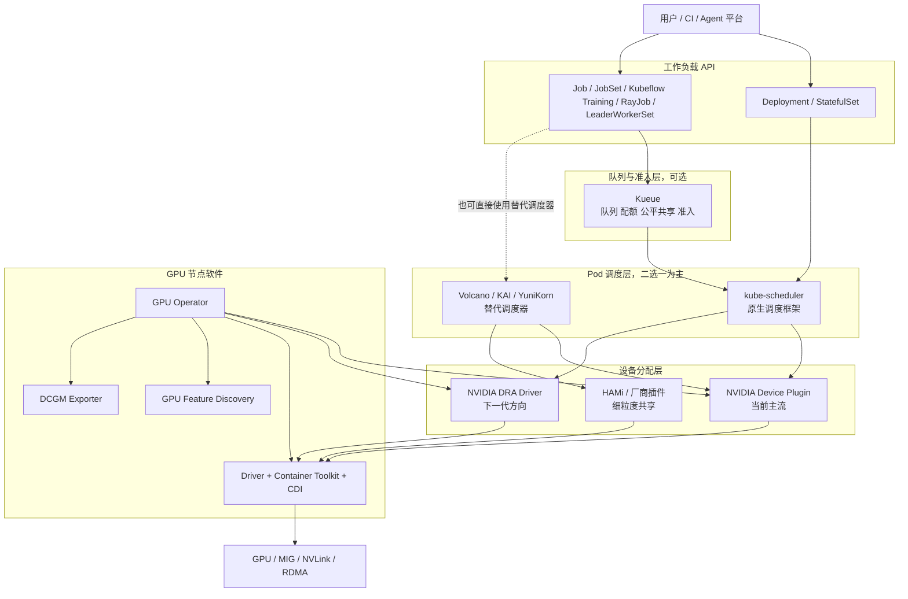
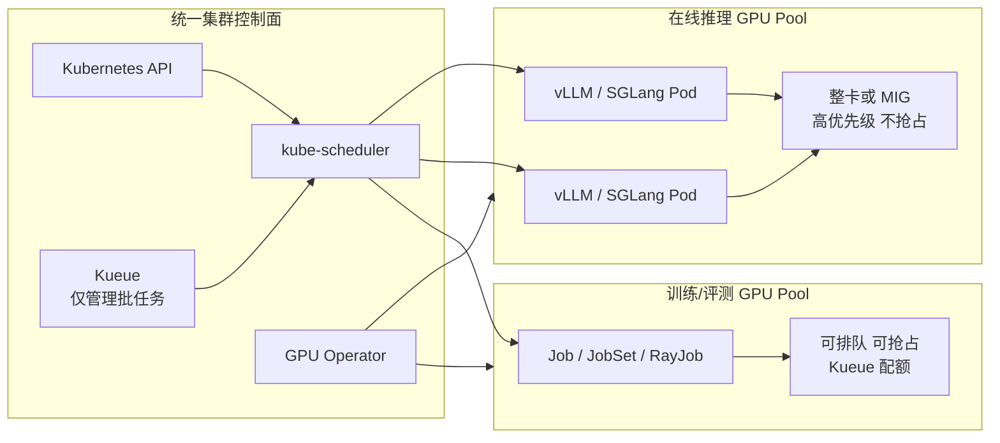

## 一、先说结论

Kubernetes GPU 调度并不存在一个覆盖所有问题的“唯一标准组件”。所谓 GPU 调度，实际至少包含下面五层：

1. GPU 驱动、容器运行时和节点发现；
2. 向 Kubernetes 声明并分配具体 GPU；
3. Pod 到节点的放置、装箱和拓扑选择；
4. 多租户队列、配额、公平共享和抢占；
5. 整卡、MIG、MPS、时间片或 vGPU 等共享与隔离方式。

截至 2026 年 9 月，可以把“事实标准”更准确地表述为：

| 范围 | 当前结论 | 推荐选择 |
| --- | --- | --- |
| NVIDIA GPU 接入 Kubernetes | **事实上的默认基线** | NVIDIA GPU Operator + NVIDIA Device Plugin |
| 普通 Pod 到节点调度 | **Kubernetes 原生标准** | kube-scheduler |
| AI/批任务队列与配额 | **上游 Kubernetes 原生方向**，但不是替代调度器 | Kueue + kube-scheduler |
| 强 Gang、DRF、批处理插件化调度 | 没有全行业唯一标准，Volcano 是最成熟、常见的开源选择之一 | Volcano |
| 下一代设备声明与分配 | **DRA 是 Kubernetes 上游标准方向** | Kubernetes DRA + NVIDIA DRA Driver，先试点再替换 Device Plugin |
| 细粒度 GPU 共享 | 没有统一标准 | 优先 MIG；简单场景用 time-slicing/MPS；多厂商或细粒度 vGPU 看 HAMi |

一句话推荐：

> 在线推理先采用 **GPU Operator + Device Plugin + kube-scheduler**；多团队训练在其上增加 **Kueue**；确实需要强 Gang、DRF 或复杂批调度插件时再评估 **Volcano**。不要一开始就同时部署 Kueue、Volcano、KAI、HAMi 和 DRA。

这里要区分两个“标准”：

- **当前生产装机基线**仍是 Device Plugin 路径。Kubernetes 官方文档仍将 AMD/NVIDIA GPU 管理描述为稳定的 Device Plugin 能力；
- **未来 API 标准**是 Dynamic Resource Allocation（DRA）。DRA 核心在 Kubernetes 1.34 GA，DRA Extended Resource 桥接能力在 1.37 GA，但 NVIDIA DRA Driver 自身仍有部分 Alpha 能力，不能仅凭“Kubernetes API 已 GA”就判断整个厂商实现已经完全成熟。

## 二、不要把不同层的组件混为一谈



这张图里最容易混淆的是 Kueue：Kueue 不负责把 Pod 放到某块 GPU 上，也不替换 kube-scheduler。它在 Pod 真正进入调度前决定“哪个工作负载现在可以消耗多少配额”。准入后，Pod 的节点选择仍交给 kube-scheduler。

GPU Operator 也不是高级调度器。它主要解决 GPU 节点软件生命周期，调度策略仍由 kube-scheduler、Kueue 或替代调度器完成。

## 三、Kubernetes 原生能力

### 3.1 Device Plugin：当前生产基线

NVIDIA Device Plugin 把 GPU 以扩展资源的形式暴露给 Kubernetes，例如 `nvidia.com/gpu`。Pod 通过 `limits` 请求整卡：

```yaml
apiVersion: v1
kind: Pod
metadata:
  name: llm-worker
spec:
  containers:
    - name: worker
      image: vllm/vllm-openai:latest
      resources:
        limits:
          nvidia.com/gpu: 1
```

这条路径成熟、简单、生态兼容性最好，但传统 Device Plugin 有几个天然限制：

- kube-scheduler 通常只看到某节点有几张 GPU，看不到更丰富的单卡属性和动态配置；
- 具体设备 ID 主要在节点侧分配，调度器难以做全局最优的设备级决策；
- GPU、RDMA、NUMA、NVLink 等组合资源表达不够自然；
- 设备重配置、共享策略和 Claim 生命周期缺少统一的声明式 API。

因此，Device Plugin 仍适合当前绝大部分整卡推理和训练，但不应被理解为 Kubernetes 设备管理的最终形态。

### 3.2 kube-scheduler：先用好原生能力

在引入替代调度器前，原生 kube-scheduler 已经能够完成：

- 按 `nvidia.com/gpu` 等扩展资源过滤节点；
- 使用 Node Label、Node Affinity 和 Taint/Toleration 区分 GPU 型号与资源池；
- 使用 `NodeResourcesFit` 的 `MostAllocated` 做 GPU Bin Packing；
- 使用 Topology Manager 协调 CPU、内存和设备的 NUMA 亲和性；
- 通过 Scheduling Framework 插件扩展 PreFilter、Filter、Score、Reserve、Permit 等阶段。

例如，为 GPU 资源提高装箱权重：

```yaml
apiVersion: kubescheduler.config.k8s.io/v1
kind: KubeSchedulerConfiguration
profiles:
  - schedulerName: default-scheduler
    pluginConfig:
      - name: NodeResourcesFit
        args:
          scoringStrategy:
            type: MostAllocated
            resources:
              - name: nvidia.com/gpu
                weight: 10
              - name: cpu
                weight: 1
              - name: memory
                weight: 1
```

在线推理通常比离线训练更适合这套简单路径：副本是长时间运行的 Deployment，主要诉求是稳定放置、滚动发布和故障恢复，而不是复杂的排队与 Gang Scheduling。

### 3.3 DRA：下一代标准，但要按版本验收

Dynamic Resource Allocation 使用 `ResourceClaim`、`DeviceClass` 等 API，让工作负载声明设备需求，并允许 DRA Driver 参与选择、准备和配置设备。它解决的不只是“要一张卡”，还包括：

- 按设备属性、容量和拓扑选择；
- 一个工作负载同时申请 GPU、RDMA 等设备；
- 设备的动态切分与重配置；
- Claim 独立于 Pod 生命周期复用；
- 由调度器在集群视角完成结构化设备分配。

NVIDIA DRA Driver 还提供 ComputeDomain，用于需要跨节点 NVLink/NVSwitch 域的系统。不过当前落地需要注意：

1. 核对 Kubernetes、GPU Operator、NVIDIA Driver、Container Toolkit/CDI 和 DRA Driver 的兼容矩阵；
2. 同一 GPU 资源池不要让 Device Plugin 和 DRA Driver 重复声明设备；
3. 区分 DRA 核心 API 的稳定级别与驱动某项能力的稳定级别；
4. 先在独立节点池试点，再迁移生产推理池。

对新集群可以预留 DRA 架构，但当前不必为了“追标准”立即替换成熟的 Device Plugin 路径。

## 四、主要开源组件对比

| 组件 | 所在层 | 核心能力 | 是否替换 kube-scheduler | 更适合 | 主要代价 |
| --- | --- | --- | --- | --- | --- |
| NVIDIA GPU Operator | 节点软件生命周期 | 驱动、Container Toolkit、Device Plugin/DRA、GFD、DCGM | 否 | NVIDIA GPU 集群的默认接入 | 与驱动/K8s 版本兼容性需要严格管理 |
| NVIDIA Device Plugin | 设备暴露与分配 | 整卡、MIG、time-slicing、MPS | 否 | 成熟的整卡推理与训练 | 设备级全局调度表达有限 |
| kube-scheduler | Pod 放置 | 过滤、打分、抢占、装箱、调度扩展点 | 它本身就是默认调度器 | 在线服务、普通 Job | 没有完整的批任务队列与公平共享语义 |
| Kueue | 工作负载准入 | ClusterQueue、配额、Flavor、公平共享、借用、抢占、TAS、MultiKueue | **否** | 多团队训练、评测和批推理 | 需要理解“准入”和“Pod 调度”的边界 |
| Volcano | 批处理替代调度器 | Gang、DRF、Queue、Proportion、Binpack、NUMA、拓扑插件 | **是** | MPI、强 Gang、AI/HPC 批任务 | 接管调度链路，运维和迁移成本更高 |
| KAI Scheduler | GPU 优先的替代调度器 | 分层队列、公平共享、回收/抢占、Gang、拓扑、GPU sharing | **是** | 希望采用 NVIDIA/Run:ai 开源调度能力的 GPU 平台 | 项目较新，需验证版本成熟度和生态兼容性 |
| Koordinator | QoS 与设备调度平台 | Device CRD、vGPU、GPU/RDMA 联合分配、NUMA/拓扑 | 通常使用 koord-scheduler | 在线离线混部、异构设备调度 | 引入 koordlet、scheduler、manager 等整套体系 |
| Apache YuniKorn | 通用批处理替代调度器 | 分层队列、Fair/FIFO、配额、Gang | **是** | 已有 Hadoop/Spark 队列治理经验的环境 | GPU 专属能力与 AI 生态热度不如前几项 |
| HAMi | 异构设备虚拟化与共享 | GPU 显存/算力切分、拓扑、多厂商设备、监控 | 可与其他调度器集成 | 细粒度共享、多种国产加速卡 | 数据路径和调度链路更复杂，需要单独做隔离验证 |

### 4.1 Kueue：推荐的队列与配额层

Kueue 是 Kubernetes SIG Scheduling 体系下的工作负载级队列管理器。它的关键设计是延迟创建或放行 Pod，直到工作负载获得配额准入。其优势包括：

- `LocalQueue` 和 `ClusterQueue` 分离租户入口与集群资源治理；
- 使用 `ResourceFlavor` 表示不同 GPU 型号、可用区或节点池；
- 支持配额借用、Cohort、公平共享和抢占；
- 支持 Job、JobSet、Kubeflow Training Operator、Ray、LeaderWorkerSet 等 AI 工作负载；
- Topology-Aware Scheduling（TAS）可按机架、网络块等域做准入；
- MultiKueue 可将工作负载分发到多个集群；
- 能够管理 DRA 资源配额。

Kueue 的 All-or-Nothing 准入解决的是“配额够不够”，不天然保证最终所有 Pod 都能落到满足物理约束的节点上；需要结合 TAS、节点标签和 kube-scheduler 的放置约束。这个边界是 Kueue 与 Volcano Gang Scheduling 的重要区别。

适合 Kueue 的判断标准是：

> 想保留 Kubernetes 默认调度器和现有工作负载 API，只增加排队、配额和公平共享。

### 4.2 Volcano：强批调度能力

Volcano 是面向高性能计算和 AI 批任务的完整调度系统。它通过 `schedulerName: volcano` 接管相关 Pod，并提供插件化调度动作和算法：

- Gang：达到 `minAvailable` 才运行，避免分布式任务部分占卡后互相等待；
- DRF：按多种资源的主导份额实现公平分配；
- Queue、Proportion、Priority、Preemption；
- Binpack、NodeOrder、NUMA-aware、Task Topology；
- 面向 Job 的批处理控制器和 `VolcanoJob` API。

如果必须实现严格 Gang、复杂 DRF/队列策略或希望调度器直接掌控批任务生命周期，Volcano 比“Kueue + 默认调度器”更完整，但也更具侵入性。

Volcano 旧的 GPU Sharing 能力已经弃用，官方文档建议这类需求转向 HAMi。选用 Volcano 不等于自动获得可靠的显存隔离。

### 4.3 KAI Scheduler：值得跟踪，但不是默认答案

KAI Scheduler 是 NVIDIA 开源的、源自 Run:ai 核心调度能力的 GPU 调度器，提供：

- 分层 Queue、保底配额、上限和超额资源权重；
- 队列间 Reclaim、队列内 Preemption；
- Gang Scheduling 与 PodGroup；
- 机架/区域等多级拓扑感知；
- GPU Bin Packing 和分数 GPU 请求；
- Scheduling Shard，将不同节点池交给独立调度实例。

它比 Kueue 更直接地接管 Pod 调度，也比通用批调度器更强调 GPU 利用率。但它仍是较新的开源选项。其原生 GPU Sharing 默认不等于 CUDA 级显存硬隔离，官方文档也提供与 HAMi Resource Isolator 集成的路径。

因此，除非团队明确需要 KAI 的队列模型、拓扑或 GPU sharing，并愿意承担替代调度器的验收工作，否则不应仅因为它来自 NVIDIA 就把它当作默认标准。

### 4.4 Koordinator 与 YuniKorn

Koordinator 的 Device CRD 能统一表达 GPU、RDMA、FPGA 等设备信息，由 koord-scheduler 做设备级和拓扑级决策，并可通过 HAMi 完成 NVIDIA vGPU 分配。它还适合在线/离线混部和更完整的 QoS 治理。代价是平台面较宽，如果需求只是“给 vLLM Pod 分一张整卡”，引入整套 Koordinator 明显过重。

YuniKorn 提供成熟的分层队列、Fair/FIFO 排序、配额和 Gang Scheduling，适合已经熟悉 Hadoop/YARN 式资源队列治理的组织。它是优秀的通用批调度器，但不是 GPU 设备接入或虚拟化组件，在 AI/Kubernetes 新项目中通常优先比较 Kueue、Volcano 和 KAI。

## 五、GPU 共享方式如何选择

| 方式 | 隔离强度 | 优点 | 局限 | 推荐场景 |
| --- | --- | --- | --- | --- |
| 整卡独占 | 强 | 行为简单、性能稳定、故障域清晰 | 小模型可能浪费显存 | 生产 LLM 推理、大模型训练 |
| MIG | 硬件级 | 显存、算力和故障隔离更强 | 仅部分 NVIDIA GPU 支持，实例规格固定且需重配置 | 多租户推理、稳定小模型服务 |
| MPS | 进程级共享 | 可并发使用 GPU，并支持一定的资源分配 | 限制较多，隔离不等同 MIG | 受控的同可信工作负载 |
| Time-slicing | 很弱 | 配置简单，提高轻负载利用率 | 不提供显存和故障隔离，超显存会互相影响 | 开发测试、可信批任务 |
| HAMi vGPU | 软件级 | 显存/算力切分、多厂商、调度感知更细 | 增加 Device Plugin/运行时/调度集成复杂度 | 无 MIG 时的细粒度共享、异构加速卡平台 |

NVIDIA Device Plugin 的 time-slicing 与 MPS 不能同时用于同一资源。尤其要注意：time-slicing 只是让多个容器轮流使用同一张卡，并不会阻止一个容器耗尽整卡显存，也不会隔离 GPU 故障域。

对在线 LLM 服务，推荐优先级通常是：

```text
整卡独占 > MIG > 经严格压测的 HAMi/MPS > time-slicing
```

吞吐率不是唯一指标。共享方案还必须测试 P99 TTFT、P99 TPOT、OOM 相互影响、故障传播和模型加载峰值。

## 六、推荐的最小生产架构

结合上一章的 vLLM/SGLang 推理基础设施，建议把在线推理和批训练分池治理：



### 6.1 第一阶段：先跑稳整卡推理

组件保持最少：

```text
Kubernetes
  + NVIDIA GPU Operator
  + NVIDIA Device Plugin
  + GPU Feature Discovery / Node Feature Discovery
  + kube-scheduler
  + DCGM Exporter + Prometheus + Grafana
```

实施要点：

- 以节点标签区分 GPU 产品、显存、互联方式和生命周期；
- 使用 Taint/Toleration 隔离 GPU 节点，避免普通负载误占；
- 在线推理和训练使用不同节点池；
- 推理 Pod 请求整卡或 MIG 资源；
- 使用 `MostAllocated` 减少 GPU 碎片，但为故障恢复保留容量；
- GPU Operator、驱动、CUDA、Kubernetes、Device Plugin 统一版本矩阵；
- DCGM 监控 GPU 利用率、显存、功耗、温度、ECC/Xid 错误。

这一步不需要 Kueue、Volcano、HAMi 或自研 Scheduler。

### 6.2 第二阶段：有排队和多租户需求时增加 Kueue

当训练、离线评测、模型量化等任务开始争抢 GPU 时，再增加：

```text
Kueue
  + ClusterQueue：集群级 GPU 配额
  + LocalQueue：团队/Namespace 提交入口
  + ResourceFlavor：H100、A100、L40S 等资源池
  + Cohort/Fair Sharing：借用与公平共享
  + PriorityClass：在线、紧急评测、普通训练
  + TAS：机架/网络块拓扑准入
```

在线推理 Deployment 可以继续直接由 kube-scheduler 调度，不必强行进入 Kueue。Kueue 主要治理可等待、可重试的批工作负载。

### 6.3 第三阶段：满足明确条件才换调度器

出现下面任一需求时，才进入 Volcano、KAI 或 Koordinator 的 PoC：

- 分布式任务必须强 Gang，部分启动会造成长时间占卡死锁；
- 需要 DRF、复杂队列层级、回收和可定制调度 Action；
- GPU/NIC/NUMA/NVLink 拓扑对性能有决定性影响；
- 需要调度器直接选择卡级资源或细粒度显存；
- 需要在线离线混部和完整 QoS 干预。

PoC 必须用相同任务集比较：排队时延、GPU 利用率、调度吞吐、故障恢复、抢占代价、升级回滚和 CRD/API 迁移成本，而不能只比较功能列表。

### 6.4 第四阶段：独立节点池试点 DRA

当使用的 Kubernetes 与 GPU Operator 版本都稳定支持所需 DRA 能力后：

1. 创建独立的 DRA GPU 节点池；
2. 禁止 Device Plugin 和 DRA Driver 对同一批 GPU 重复注册；
3. 从非关键批任务开始验证 ResourceClaim；
4. 验证节点重启、控制面故障、Claim 回收和滚动升级；
5. 再逐步迁移需要 GPU/RDMA 联合分配或 ComputeDomain 的工作负载。

## 七、调度策略设计

### 7.1 GPU 型号不是字符串约定，而是资源契约

不要让业务通过任意 `nodeSelector` 拼接 GPU 型号。平台应提供有限的资源类别，例如：

```text
gpu-infer-high: H100/H200，低延迟在线推理
gpu-infer-mid:  L40S，普通推理
gpu-train:      H100，NVLink/RDMA，多卡训练
gpu-dev:        共享或低规格卡，开发测试
```

在 Kueue 中可以映射为 `ResourceFlavor`，在普通 Deployment 中则由平台生成 Node Affinity、Toleration 和 PriorityClass。这样才能调整底层机型而不修改每个业务清单。

### 7.2 Bin Packing 与 Spread 要按工作负载区分

- 单卡推理副本：优先 Bin Packing，释放完整节点用于大任务；
- 同一模型多副本：跨节点或可用区 Spread，降低单节点故障影响；
- 张量并行：优先同节点 NVLink/NVSwitch；
- 多机训练：优先同机架、同网络块，并联合考虑 RDMA；
- Checkpoint/模型缓存：考虑本地盘和镜像/权重缓存命中，但不能让软亲和性破坏容量安全。

调度层决定 Pod 去哪个节点；vLLM/SGLang Router 决定请求去哪个推理副本。前者是分钟级容量与故障域问题，后者是毫秒级负载、KV Cache 和前缀命中问题，两者不能相互替代。

### 7.3 抢占策略

建议建立清晰的优先级：

```text
P0：系统组件、GPU Operator、网络与存储插件
P1：在线推理，不允许被普通训练抢占
P2：紧急评测、发布前压测
P3：普通训练与批推理，可重试
P4：回填任务、实验任务，可随时中断
```

训练任务被抢占前应支持 Checkpoint；没有 Checkpoint 的长任务即使技术上可抢占，经济上也可能不适合抢占。

## 八、常见误区

### 8.1 “安装 GPU Operator 就有高级 GPU 调度”

错误。GPU Operator 主要安装和维护 GPU 软件栈。队列公平、Gang、GPU 装箱等仍由调度层处理。

### 8.2 “Kueue 和 Volcano 二选一，因为它们都是调度器”

不准确。Kueue 是准入和配额管理器，默认仍使用 kube-scheduler；Volcano 是替代调度器。可以基于需求比较它们提供的最终效果，但两者所在层次不同。

### 8.3 “GPU 使用率低，开启 time-slicing 就能解决”

不一定。LLM 推理可能是显存容量、内存带宽或 KV Cache 受限，SM 利用率低并不代表安全可共享。time-slicing 也不提供显存和故障隔离。

### 8.4 “Kubernetes DRA 已 GA，所以 NVIDIA DRA 所有能力都生产就绪”

错误。Kubernetes API、某个 DRA 扩展特性和具体厂商 Driver 各自有独立的稳定级别及版本要求，必须逐项检查。

### 8.5 “同时部署多个 Scheduler 可以获得所有能力”

多个 Scheduler 可以并存，但每个 Pod 只能由指定的 `schedulerName` 负责。多套队列、抢占和设备分配体系容易出现资源视图不一致、重复预留和排障边界模糊。除隔离 PoC 外，生产中应确定一个主要 Pod 调度器。

## 九、最终选型表

| 场景 | 推荐方案 |
| --- | --- |
| 单团队、整卡在线推理 | GPU Operator + Device Plugin + kube-scheduler |
| 多模型在线推理 | 上述方案 + 节点池/Flavor 规范；副本内部使用 vLLM/SGLang Router |
| 多团队训练、评测、批推理 | 上述方案 + Kueue |
| MPI/大规模分布式训练、强 Gang | Volcano；或先验证 Kueue TAS/All-or-Nothing 是否已满足需求 |
| 希望采用 GPU 优先的分层队列、拓扑和回收策略 | PoC KAI Scheduler，与 Volcano 做实测比较 |
| 在线离线混部、GPU/RDMA 联合和设备级 QoS | PoC Koordinator |
| 无 MIG 条件下需要细粒度或多厂商 GPU 共享 | HAMi，并做显存隔离和故障域测试 |
| 新建高端 GPU 集群，需要 GPU/RDMA、ComputeDomain | 独立节点池试点 DRA |
| 已有 YARN/Spark 分层队列治理经验 | 可评估 YuniKorn |

对本文对应的大模型推理平台，最终建议是：

```text
现在：GPU Operator + Device Plugin + kube-scheduler
批任务增多：+ Kueue
确有强 Gang/DRF：评估 Volcano
确有细粒度共享：MIG 优先，否则评估 HAMi
DRA：预留接口、独立试点，不立即全量替换
```

这套方案自研工作量最小：自研部分只需要维护 GPU 资源类别、工作负载模板、队列/优先级策略和观测告警，不需要自己编写 Scheduler、Device Plugin 或 vGPU Runtime。

## 十、参考资料

- [Kubernetes：Schedule GPUs](https://kubernetes.io/docs/tasks/manage-gpus/scheduling-gpus/)
- [Kubernetes：Dynamic Resource Allocation](https://kubernetes.io/docs/concepts/resource-management/dynamic-resource-allocation/)
- [Kubernetes 1.34：DRA Core GA](https://kubernetes.io/blog/2025/09/01/kubernetes-v1-34-dra-updates/)
- [Kubernetes 1.37：DRA Extended Resources GA](https://kubernetes.io/blog/2026/09/03/kubernetes-v1-37-dra-updates/)
- [Kubernetes Scheduling Framework](https://kubernetes.io/docs/concepts/scheduling-eviction/scheduling-framework/)
- [Kubernetes：Resource Bin Packing](https://kubernetes.io/docs/concepts/scheduling-eviction/resource-bin-packing/)
- [Kubernetes：Topology Manager](https://kubernetes.io/docs/tasks/administer-cluster/topology-manager/)
- [NVIDIA GPU Operator](https://docs.nvidia.com/datacenter/cloud-native/gpu-operator/latest/)
- [NVIDIA Kubernetes Device Plugin](https://github.com/NVIDIA/k8s-device-plugin)
- [NVIDIA DRA Driver](https://docs.nvidia.com/datacenter/cloud-native/gpu-operator/26.7/dra-intro-install.html)
- [Kubernetes SIGs：NVIDIA DRA Driver](https://github.com/kubernetes-sigs/dra-driver-nvidia-gpu)
- [Kueue Overview](https://kueue.sigs.k8s.io/docs/overview/)
- [Kueue All-or-Nothing](https://kueue.sigs.k8s.io/docs/concepts/all_or_nothing/)
- [Kueue Topology-Aware Scheduling](https://kueue.sigs.k8s.io/docs/concepts/topology_aware_scheduling/)
- [Volcano Scheduler](https://volcano.sh/docs/scheduler/overview/)
- [Volcano Gang Plugin](https://volcano.sh/docs/scheduler/plugins/gang/)
- [Volcano GPU Sharing 迁移说明](https://volcano.sh/docs/userguide/user_guide_how_to_use_gpu_sharing/)
- [KAI Scheduler：Queues](https://github.com/kai-scheduler/KAI-Scheduler/blob/main/docs/queues/README.md)
- [KAI Scheduler：Topology-Aware Scheduling](https://github.com/kai-scheduler/KAI-Scheduler/blob/main/docs/topology/README.md)
- [KAI Scheduler：GPU Sharing](https://github.com/kai-scheduler/KAI-Scheduler/blob/main/docs/gpu-sharing/README.md)
- [Koordinator Device Architecture](https://koordinator.sh/docs/architecture/device)
- [Apache YuniKorn Features](https://yunikorn.apache.org/docs/get_started/core_features/)
- [HAMi](https://github.com/Project-HAMi/HAMi)
