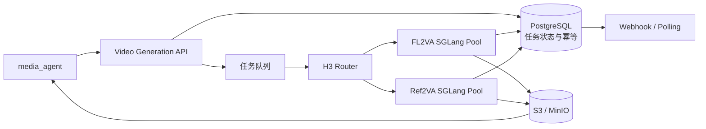
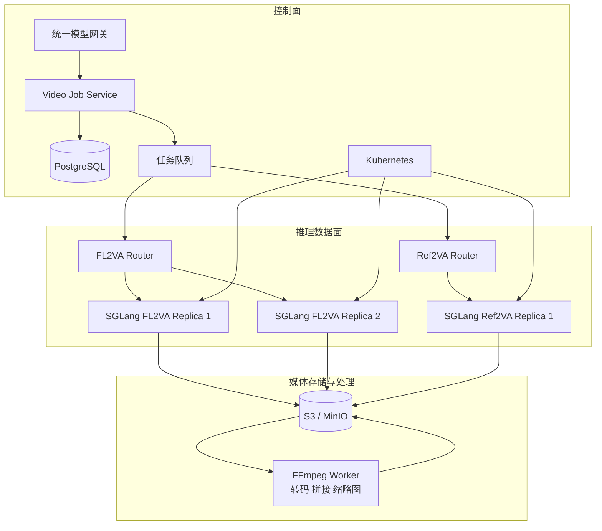

## 一、结论

如果目标是把 MiniMax H3 接入 `media_agent`，推荐采用下面的组合，而不是在 ComfyUI 和 SGLang 之间二选一：

```text
ComfyUI：模型效果验证、参数实验和 Golden Case 制作
SGLang：正式的 H3-Base 推理服务
media_agent：异步任务编排、素材管理和业务流程
S3/MinIO：输入素材与生成结果存储
MiniMax API（可选）：复现官方 Context-IR 和 Regenerate-2K；纯本地可以只运行 H3-Base
```

如果已有完整的 vLLM 运维体系，并且特别看重 `/v1/videos` 异步接口，可以选择 vLLM-Omni。就目前 H3 的官方示例、硬件配方和性能验证完整度而言，H3 首次生产部署优先选择 SGLang 更稳妥。

## 二、真正的区别不在有没有前端

本文不讨论 ComfyUI 的可视化前端和工作流编辑能力，只讨论推理部分。

从推理系统的定位看：

```text
ComfyUI：面向单次生成任务的推理计算图执行器
SGLang / vLLM-Omni：面向长期运行服务的模型推理运行时
```

它们最终都可能调用相同的 PyTorch/CUDA 算子、Attention Kernel、VAE 和模型权重。框架名称本身不会改变模型能力，真正影响结果和性能的是：

- 使用了哪个 Checkpoint、量化格式和计算精度；
- Prompt、参考素材、随机种子和采样参数；
- Attention Backend 与算子实现；
- 模型如何分布到 GPU、CPU 和主机内存；
- 视频 Latent 如何在多张 GPU 间切分；
- 一个实例如何排队和并发处理请求。

### 2.1 推理维度对比

| 维度 | ComfyUI | SGLang / vLLM-Omni |
| --- | --- | --- |
| 推理组织方式 | 每次提交一个计算图，按节点依赖执行 | 启动时固定模型拓扑，常驻等待请求 |
| 模型生命周期 | 根据工作流加载、卸载和 Offload | 通常保持模型或关键层常驻 |
| 显存管理目标 | 尽可能让模型在有限显存上运行 | 在确定的硬件拓扑下优化稳定吞吐 |
| 缓存对象 | 未改变节点的输出和已加载模型 | 模型状态、编译结果和请求阶段数据 |
| 多 GPU | 取决于具体节点和模型实现 | TP、Ulysses、Pipeline 等是运行时能力 |
| 请求队列 | Prompt Queue | 模型服务请求队列、并发和异步任务 |
| API 契约 | 工作流 JSON 与节点定义强相关 | 面向业务参数的 HTTP API |
| 横向扩容 | 可以复制实例，但需要自行封装 | 更适合作为 Kubernetes 推理 Worker |
| 扩展方式 | Custom Node，灵活但依赖容易漂移 | 模型适配代码和固定服务配置 |
| 主要目标 | 单任务灵活性、低显存运行、快速实验 | 吞吐、稳定性、并发和多 GPU 效率 |

### 2.2 ComfyUI 的执行特点

ComfyUI 会从输出节点反向计算依赖关系，只执行生成结果所需的节点。再次提交相似工作流时，没有变化的节点可以复用缓存结果。

其模型管理层还负责：

- 根据显存压力加载和卸载模型；
- 在 CPU 与 GPU 之间移动模型；
- Low VRAM、Normal VRAM 等显存策略；
- 缓存节点输出及已加载的模型对象；
- OOM 后释放模型和显存；
- 对 VAE、Text Encoder、DiT 等组件分别管理。

这种设计非常适合不断调整采样器、LoRA、输入素材和后处理链路。它首先优化的是“让复杂工作流可以执行”和“让大模型在有限显存上运行”，不天然等于高并发模型服务。

参考：[ComfyUI Execution](https://github.com/Comfy-Org/ComfyUI/blob/master/execution.py)、[ComfyUI Model Management](https://github.com/Comfy-Org/ComfyUI/blob/master/comfy/model_management.py)。

### 2.3 SGLang/vLLM-Omni 的执行特点

模型服务运行时通常在启动时完成：

1. 解析模型结构和 Checkpoint；
2. 创建 GPU 通信组；
3. 确定 Tensor Parallel、Sequence Parallel 或 Pipeline 拓扑；
4. 加载、量化或 Offload 权重；
5. 预热 Kernel 和显存；
6. 启动固定的 HTTP/任务接口；
7. 持续处理同一种模型请求。

这种结构没有任意工作流图灵活，但容器配置、资源边界、监控指标和横向扩容更容易标准化。

## 三、H3 和普通 LLM 的推理过程不同

### 3.1 自回归 LLM

vLLM 和 SGLang 最初优化的是自回归语言模型：

```text
Prompt
  → Prefill
  → 生成 KV Cache
  → 每次生成一个 Token
  → 不同请求动态加入或退出 Batch
```

主要优化技术包括：

- Paged KV Cache；
- Continuous Batching；
- Prefix Cache；
- Chunked Prefill；
- Prefill/Decode 分离；
- Token 级请求调度。

### 3.2 MiniMax H3

H3 是视频和音频联合生成模型，推理流程更接近：

```text
文本、图片、视频、音频
  → Processor / Tokenizer
  → Qwen3-VL Text/Context Encoder
  → 多模态条件表示
  → H3 FL2VA 或 Ref2VA DiT
  → 视频和音频 Latent 多步去噪
  → Video VAE + Audio VAE 解码
  → 视频和立体声音频
```

H3 推理的关键问题不是 KV Cache，而是：

- 巨大的 DiT 与 Text Encoder 权重如何放置；
- 每一步去噪的 Attention 如何并行；
- 视频 Latent 如何跨 GPU 切分；
- VAE 解码阶段的峰值显存；
- CPU Offload 产生的 PCIe 传输开销；
- 一个长任务占用 GPU 时其他任务如何排队；
- 大尺寸参考视频的预处理和结果文件存储。

因此，不能因为传统 vLLM 擅长 LLM，就直接推断它一定更适合视频模型。部署 H3 时需要使用 vLLM-Omni 或 SGLang Diffusion，而不是只支持自回归 LLM 的普通运行方式。

参考：[vLLM-Omni H3 Architecture](https://docs.vllm.ai/projects/vllm-omni/en/latest/design/architecture_overview/)。

## 四、ComfyUI 在 H3 推理上的价值

### 4.1 快速验证不同推理链路

ComfyUI 适合验证：

- T2VA、FL2VA 和 Ref2VA；
- 文本、首帧、尾帧和首尾帧控制；
- 图片、视频、音频参考条件；
- Base 与 Turbo LoRA；
- BF16、FP8、INT8 等不同精度；
- 采样步数、帧数、分辨率和随机种子；
- 前置图片生成、插帧、超分和后期处理；
- 音频合成、视频拼接和封装格式。

完整的视频生成产品通常不是一次模型调用，而是较长的媒体处理链。ComfyUI 可以用很低的开发成本验证这条链路。

### 4.2 低显存运行

ComfyUI 可以根据显存将部分模型放到 CPU 或主机内存，并在执行到对应节点时再迁移到 GPU。

```text
GPU 显存不足
  → 权重保存在 CPU 内存或映射文件
  → 每层计算前传输到 GPU
  → 计算完成后回收或换出
```

这解决的是“能不能运行”，不等于“适合生产”。当大量权重需要逐层传输时，GPU 会等待 PCIe 和主机内存，生成一个视频可能需要几分钟甚至更长。

### 4.3 容易检查中间环节

H3 推理失败或效果不佳时，可以分别检查：

- 输入图片是否正确缩放；
- Reference Video 的采样帧是否正确；
- Prompt Conditioning 是否符合预期；
- FL2VA 与 Ref2VA Checkpoint 是否匹配；
- Latent、VAE 和音频节点在哪一步失败；
- LoRA、量化和采样参数是否生效。

### 4.4 ComfyUI 直接生产化的代价

ComfyUI 有 API 和 Prompt Queue，也可以作为无界面 Worker，但如果直接面向生产业务，还需要补充：

- 租户认证和权限；
- 幂等提交；
- 持久化任务状态；
- 超时、取消和重试；
- 多实例 GPU 调度；
- Worker 心跳和故障转移；
- 输出对象存储；
- 工作流版本管理；
- Custom Node 依赖锁定和安全治理；
- 与业务隔离的稳定请求/响应协议。

ComfyUI 可以成为生产 Worker，但不应直接充当完整的模型服务平台。

## 五、SGLang 在 H3 上的价值

MiniMax 官方模型卡直接提供了 SGLang 部署方式：

```bash
sglang serve \
  --model-path MiniMaxAI/MiniMax-H3 \
  --num-gpus 4 \
  --ulysses-degree 4 \
  --performance-mode speed \
  --host 0.0.0.0 \
  --port 30010 \
  --model-variant fl2va
```

Ref2VA 使用另一个服务实例：

```bash
sglang serve \
  --model-path MiniMaxAI/MiniMax-H3 \
  --num-gpus 4 \
  --ulysses-degree 4 \
  --performance-mode speed \
  --host 0.0.0.0 \
  --port 30011 \
  --model-variant ref2va
```

参考：[MiniMax H3 官方模型卡](https://huggingface.co/MiniMaxAI/MiniMax-H3)。

SGLang 对 H3 的主要价值包括：

- 原生解析 FL2VA 和 Ref2VA Checkpoint；
- Ulysses Sequence Parallel；
- Tensor Parallel；
- Layerwise Offload；
- 针对不同 GPU 数量和显存的部署配方；
- NVIDIA 与 AMD GPU 支持；
- 常驻模型服务和固定请求协议；
- 可复制的容器、启动参数和性能基准。

SGLang 官方 Cookbook 显示，H3 权重约为 108GB：

```text
DiT：约 61.7GB
Text Encoder：约 46.2GB
另有 Video VAE、Audio VAE 等组件
```

通过 Layerwise Offload，H3 可以在 12～16GB 显存的设备上运行，但需要大量主机内存、内存映射和权重传输。这适合功能验证，不适合作为高吞吐生产配置。

参考：[SGLang MiniMax H3 Cookbook](https://github.com/sgl-project/sglang/blob/main/docs/cookbook/diffusion/MiniMax/MiniMax-H3.mdx)。

### 5.1 SGLang 不一定产生数量级性能提升

在相同权重、采样器、随机种子和精度下，ComfyUI 与 SGLang 执行的模型数学过程接近。SGLang 的核心收益主要来自：

- 明确的多 GPU 拓扑；
- 更完整的模型专用优化；
- 服务参数固定；
- 更容易压测和监控；
- 更容易水平复制 Worker；
- 更适合纳入 Kubernetes。

不能简单理解为“ComfyUI 慢、SGLang 快”。硬件、量化方式、Offload、Attention Backend 和采样步数的影响可能更大。

## 六、vLLM-Omni 的位置

vLLM-Omni 已支持 MiniMax H3，并提供 OpenAI 风格的视频生成接口：

```http
POST   /v1/videos
GET    /v1/videos/{video_id}
GET    /v1/videos/{video_id}/content
DELETE /v1/videos/{video_id}
```

`POST /v1/videos` 返回异步任务 ID。调用方轮询状态，任务完成后再下载视频，避免一个 HTTP 请求阻塞数分钟。

参考：[vLLM-Omni Videos API](https://docs.vllm.ai/projects/vllm-omni/en/latest/serving/videos_api/)。

vLLM-Omni 更适合：

- 已经使用 vLLM 管理其他模型；
- 网关已经适配 OpenAI 风格接口；
- 希望文本、语音、图片和视频使用相似的服务管理方式；
- 希望直接使用标准异步视频任务 API；
- 运维团队更熟悉 vLLM。

但不要把 vLLM 在语言模型上的 Continuous Batching 优势直接套到 H3。当前 vLLM-Omni H3 的 DiT 执行仍以 generation request 对应 diffusion batch 为主，通过服务并发提高整体吞吐，而不是像 LLM 一样让请求在每个 Token 阶段动态加入和退出 Batch。

## 七、MiniMax H3 的部署边界

### 7.1 两类 Base Checkpoint

MiniMax H3 Base 提供两个任务 Checkpoint：

| Checkpoint | 支持的主要任务 | 输入条件 |
| --- | --- | --- |
| FL2VA | T2VA、首帧/尾帧/首尾帧生成视频与音频 | 文本，可选首尾帧 |
| Ref2VA | Reference-to-Audio-Video | 文本、参考图片、视频和音频 |

这两个 Checkpoint 都包含其任务所需的 Omni Transformer、Processor、Tokenizer、Text Encoder、Visual VAE 和 Audio VAE。

### 7.2 H3-Context-IR、H3-Base 与 H3-Regenerate-2K

完整 H3 系统不是一个单独的 Checkpoint，而是三段式生成链路：

```text
用户文本、图片、视频和音频
            ↓
H3-Context-IR
理解并整理多模态指令
            ↓
H3-Base
生成 768p 视频和立体声音频
            ↓
H3-Regenerate-2K
结合原始上下文与 768p 结果重新生成 2K
```

目前开放权重主要覆盖 H3-Base。H3-Context-IR 和 H3-Regenerate-2K 尚未包含在开放权重中，MiniMax 提供 API 用于复现官方完整链路。因此，“使用 MiniMax API 补齐”指的是一种**可选的混合部署方式**，不是本地运行 H3-Base 的强制依赖。

#### H3-Context-IR 的职责

H3-Context-IR 是托管的多模态前处理和编排系统。它负责理解：

- 文本指令；
- 多张参考图片之间的关系；
- 参考视频中的动作和时间关系；
- 音频与目标画面的关系；
- 哪些内容需要继承，哪些内容需要生成；
- 镜头、动作、对白、环境声和音乐如何组织。

它将自由形式的多模态输入转换成 H3-Base 更容易理解的 Context Intermediate Representation。官方示例中的结果包含分镜、时间点、镜头运动、人物动作、环境声和配乐等结构化描述。

这不是普通的字符串润色。官方说明其内部包含指令解析、跨模态关联、时间理解和复杂逻辑推理，并依赖多个托管模型和多阶段服务，所以没有随 H3-Base 一起开放。

如果不调用 Context-IR API，可以在 `media_agent` 中按照官方 Prompting Guidance 自己实现 Context Builder，直接向本地 H3-Base 提交经过整理的 Prompt 和参考素材。输出质量取决于自研前处理能否正确表达复杂的多模态关系。

#### H3-Regenerate-2K 的职责

H3-Regenerate-2K 不是传统的视频超分辨率模块。普通超分只根据 768p 像素放大画面，而 Regenerate-2K 会同时使用：

```text
H3-Base 生成的 768p 视频
+ 原始文本、图片、视频和音频上下文
                    ↓
H3 In-Context Regeneration
                    ↓
重新生成的 2K 视频
```

由于重新使用了原始上下文，它可以恢复小字、人脸和细小物体等语义信息，而不是仅根据低分辨率像素猜测纹理。该模块目前同样未开放权重，官方只提供 Regenerate-2K API。

官方示例为了方便直接传输 Base64 视频；生产环境应先把 768p 视频上传到对象存储，再把可访问 URL 作为 `base_video` 提交给 API。

#### 三种部署方式

**完全本地：**

```text
media_agent Context Builder
       ↓
本地 SGLang/vLLM-Omni H3-Base
       ↓
768p 视频
       ↓
可选的本地视频超分模型
```

这种方式不依赖 MiniMax API，输入素材不会离开自己的环境。本地超分可以把视频放大到 2K 尺寸，但不等同于官方 H3 Regenerate-2K 的再生成质量。

**本地与云端混合：**

```text
原始多模态输入
       ↓
MiniMax Context-IR API
       ↓
本地 H3-Base
       ↓
768p 视频
       ↓
MiniMax Regenerate-2K API
       ↓
2K 视频
```

主要 GPU 推理由自己的 SGLang/vLLM-Omni 执行，尚未开放的 Context-IR 与 Regenerate-2K 由 MiniMax API 提供。这条路线用于尽量复现官方 2K 输出。

**完全使用 MiniMax API：**

```text
原始输入
   ↓
MiniMax 完整 H3 API
   ↓
最终视频
```

这条路线开发成本最低，但推理成本、限流、数据处理和服务可用性都依赖外部平台。

#### 数据安全边界

采用混合路线意味着两次潜在的数据出域：

1. Context-IR 需要处理原始文本、图片、视频或音频；
2. Regenerate-2K 需要处理本地生成的 768p 视频及相关上下文。

如果素材涉及隐私、客户数据或未发布内容，应先确认数据合规要求。不能出域时，应选择“自研 Context Builder + 本地 H3-Base + 本地超分”，并接受它无法完全复现官方 2K 链路。

参考：[MiniMax H3 官方模型卡](https://huggingface.co/MiniMaxAI/MiniMax-H3)、[MiniMax H3 官方仓库](https://github.com/MiniMax-AI/MiniMax-H3/blob/main/README.md)。

### 7.3 FL2VA 与 Ref2VA 建议分池

生产中建议部署为两个独立资源池：

```text
H3 FL2VA Worker Pool
  ├── T2VA
  └── 首帧/尾帧/首尾帧生成

H3 Ref2VA Worker Pool
  ├── 图片参考
  ├── 视频参考
  └── 音频参考
```

这样能够：

- 避免每个实例同时加载两套任务 DiT；
- 根据业务比例独立扩容；
- 避免复杂 Ref2VA 长任务完全阻塞 T2VA；
- 分别统计生成耗时、OOM 和失败率；
- 分别选择量化、显存和 GPU 拓扑。

如果主要业务是商品首图生成视频，第一阶段只部署 FL2VA，Ref2VA 使用较小资源池或暂时调用 API。

### 7.4 许可证

H3 使用 MiniMax H3 Community License，而不是 Apache-2.0、MIT 这类标准开源许可证。生产部署前需要检查：

- 商业使用条款；
- 对外提供生成服务的要求；
- 地域限制；
- Acceptable Use Policy；
- 模型衍生物和输出内容责任。

推理框架支持 H3，不代表自动获得额外的模型使用权。

## 八、推荐实施路线

### 8.1 第一阶段：ComfyUI 验证效果

先使用 ComfyUI 完成：

- T2VA、FL2VA 和 Ref2VA 效果比较；
- 确定主要业务需要哪个 Checkpoint；
- 确定分辨率、时长、帧数和采样步数；
- 测试 BF16、量化版本和 Turbo LoRA；
- 记录固定随机种子下的基准输出；
- 计算一条视频消耗的 GPU 时间；
- 建立可回归的 Golden Case。

Golden Case 至少记录：

```text
模型文件哈希
框架版本与 Commit
PyTorch/CUDA/Driver 版本
输入素材哈希
Prompt 与采样参数
随机种子
输出视频哈希或感知指标
各阶段耗时
峰值显存和主机内存
```

### 8.2 第二阶段：SGLang 部署 H3-Base

推荐部署：

```text
MiniMax H3
  ├── SGLang FL2VA Service
  └── SGLang Ref2VA Service
```

优先选择 SGLang 的原因：

- MiniMax 官方以 SGLang 作为主要部署示例；
- H3 Cookbook 的硬件和 Offload 配方较完整；
- 已集成 Ulysses 等视频 Latent 并行方式；
- 比使用 Diffusers 自研服务节省大量开发工作；
- 与现有 SGLang/vLLM 推理平台方向一致。

### 8.3 第三阶段：增加异步任务服务

视频生成需要较长时间，业务不应通过同步 HTTP 请求一直等待 SGLang 返回。



对外接口可以设计为：

```http
POST /v1/video-jobs
GET  /v1/video-jobs/{job_id}
POST /v1/video-jobs/{job_id}/cancel
GET  /v1/video-jobs/{job_id}/result
```

任务状态机：

```text
CREATED
  → QUEUED
  → PREPROCESSING
  → GENERATING
  → POSTPROCESSING
  → UPLOADING
  → SUCCEEDED

任意阶段
  → RETRYING
  → FAILED / CANCELLED
```

视频文件直接写入 S3/MinIO，接口只保存对象 Key、元数据和签名 URL。不要将视频 Base64 保存到 PostgreSQL、Redis 或消息队列中。

### 8.4 第四阶段：比较 vLLM-Omni

使用相同 Golden Case 比较 SGLang 与 vLLM-Omni：

- 输出一致性；
- 单任务端到端生成时间；
- GPU 秒/生成视频秒；
- 峰值显存和主机内存；
- 两个及以上并发任务的吞吐；
- 排队时间；
- 任务取消时间；
- OOM 后 Worker 是否能继续服务；
- Pod 重启后的任务恢复；
- FL2VA/Ref2VA 资源利用率；
- API 和网关集成工作量。

如果 `/v1/videos` 能显著减少网关和任务 API 开发，且性能满足要求，可以转向 vLLM-Omni；否则继续使用 SGLang。

## 九、生产部署架构

### 9.1 控制面与数据面



职责边界：

- Job Service：幂等、状态机、重试、取消和回调；
- Queue：削峰、优先级和资源池路由；
- SGLang/vLLM-Omni：执行模型推理；
- Object Storage：输入与输出文件；
- FFmpeg Worker：转码、封装、拼接、抽帧和缩略图；
- PostgreSQL：权威任务状态，不把 Redis 当持久化任务账本；
- Kubernetes：GPU Worker 部署、隔离和故障恢复。

### 9.2 Kubernetes 部署单元

多 GPU H3 实例应作为一个整体调度：

```text
一个 H3 Replica
  = 一个 Pod
  + 固定数量 GPU
  + 固定并行拓扑
  + 一个模型变体
```

例如一个 `--num-gpus 4 --ulysses-degree 4` 的实例，应一次性获得四张满足拓扑要求的 GPU。避免先启动只拿到部分 GPU 的 Pod。

关键配置包括：

- GPU 型号和显存 Node Affinity；
- 同节点 NVLink/NVSwitch 拓扑；
- GPU Taint/Toleration；
- `nvidia.com/gpu: 4` 整卡请求；
- 较大的 `/dev/shm`；
- 权重缓存使用本地 NVMe 或高吞吐共享存储；
- Readiness Probe 等待模型完整加载和预热；
- PodDisruptionBudget 防止同时驱逐多个昂贵 Worker；
- 使用队列长度而不是瞬时 GPU 利用率作为扩容信号。

H3 权重大、启动和预热成本高，不适合频繁从零扩缩容。应保留最小热副本，并基于队列等待时间做较慢的扩容决策。

## 十、指标与容量规划

视频模型不应主要使用 LLM 的 TTFT、TPOT 指标，而应监控：

| 指标 | 含义 |
| --- | --- |
| Queue Wait Time | 任务等待 GPU 的时间 |
| End-to-End Latency | 从提交到视频可下载的总时间 |
| Preprocess Time | 输入素材解码、缩放和编码时间 |
| Text Encoder Time | 条件编码耗时 |
| Denoising Time | DiT 多步去噪耗时 |
| VAE Decode Time | 视频和音频解码耗时 |
| Upload Time | 结果上传对象存储的耗时 |
| Video RTF | 生成耗时 / 生成视频时长 |
| GPU Seconds per Video Second | 每生成一秒视频消耗的 GPU 时间 |
| Peak VRAM / Host RAM | 峰值设备和主机内存 |
| OOM Rate | 显存或主机内存不足比例 |
| Failure Rate | 按模型、任务类型和参数聚合的失败率 |
| Worker Warmup Time | 新副本达到可服务状态的时间 |

成本估算可以使用：

```text
单任务 GPU 成本
  = GPU 数量 × 任务占用秒数 × 单 GPU 每秒价格

单视频秒成本
  = 单任务 GPU 成本 / 输出视频时长
```

不同分辨率、时长、采样步数和任务类型应该独立定价和限流，不能只按请求次数计费。

## 十一、最终选型

| 使用场景 | 推荐技术路线 |
| --- | --- |
| 模型效果探索、参数调整 | ComfyUI |
| 单人或少量内部创作任务 | ComfyUI Headless + 简单队列 |
| `media_agent` 正式调用、本地 768p | SGLang Diffusion |
| 已全面采用 vLLM、希望统一异步视频 API | vLLM-Omni |
| 完整官方 2K 效果 | 本地 H3-Base + MiniMax Context-IR/Regenerate-2K API；会产生数据出域 |
| 最低开发成本、快速验证业务 | 直接使用 MiniMax H3 API |
| 完全自定义底层算法和模型结构 | Diffusers + 自研 Serving |

最终建议：

> 使用 ComfyUI 建立和验证 H3 工作流，使用 SGLang 承担正式 H3-Base 推理，使用 media_agent 管理异步任务与素材。只需要本地 768p 时不依赖 MiniMax API；需要复现官方完整 2K 链路且允许数据出域时，再调用 Context-IR 与 Regenerate-2K API。

这条路线保留了 ComfyUI 在媒体工作流上的灵活性，同时避免把工作流 JSON、Custom Node 和单机 Prompt Queue 直接变成生产服务契约，也不需要从 Diffusers 开始自研整套视频推理服务器。

## 十二、参考资料

- [MiniMax H3 官方介绍](https://www.minimax.io/blog/minimax-h3)
- [MiniMax H3 Hugging Face 模型卡](https://huggingface.co/MiniMaxAI/MiniMax-H3)
- [MiniMax H3 官方仓库](https://github.com/MiniMax-AI/MiniMax-H3)
- [MiniMax H3 SGLang Cookbook](https://github.com/sgl-project/sglang/blob/main/docs/cookbook/diffusion/MiniMax/MiniMax-H3.mdx)
- [vLLM-Omni](https://docs.vllm.ai/projects/vllm-omni/en/stable/)
- [vLLM-Omni Videos API](https://docs.vllm.ai/projects/vllm-omni/en/latest/serving/videos_api/)
- [vLLM-Omni Architecture Overview](https://docs.vllm.ai/projects/vllm-omni/en/latest/design/architecture_overview/)
- [vLLM-Omni ComfyUI Integration](https://docs.vllm.ai/projects/vllm-omni/en/latest/features/comfyui/)
- [ComfyUI](https://github.com/Comfy-Org/ComfyUI)
- [ComfyUI Execution](https://github.com/Comfy-Org/ComfyUI/blob/master/execution.py)
- [ComfyUI Model Management](https://github.com/Comfy-Org/ComfyUI/blob/master/comfy/model_management.py)
